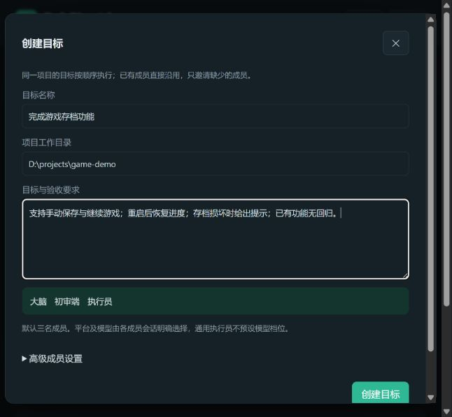
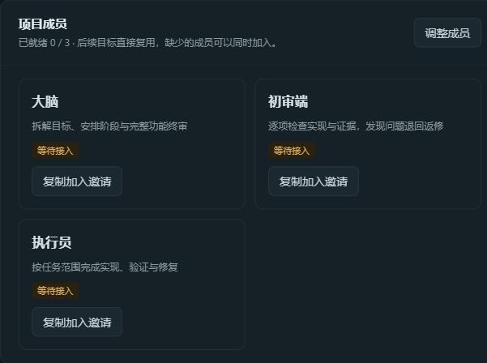
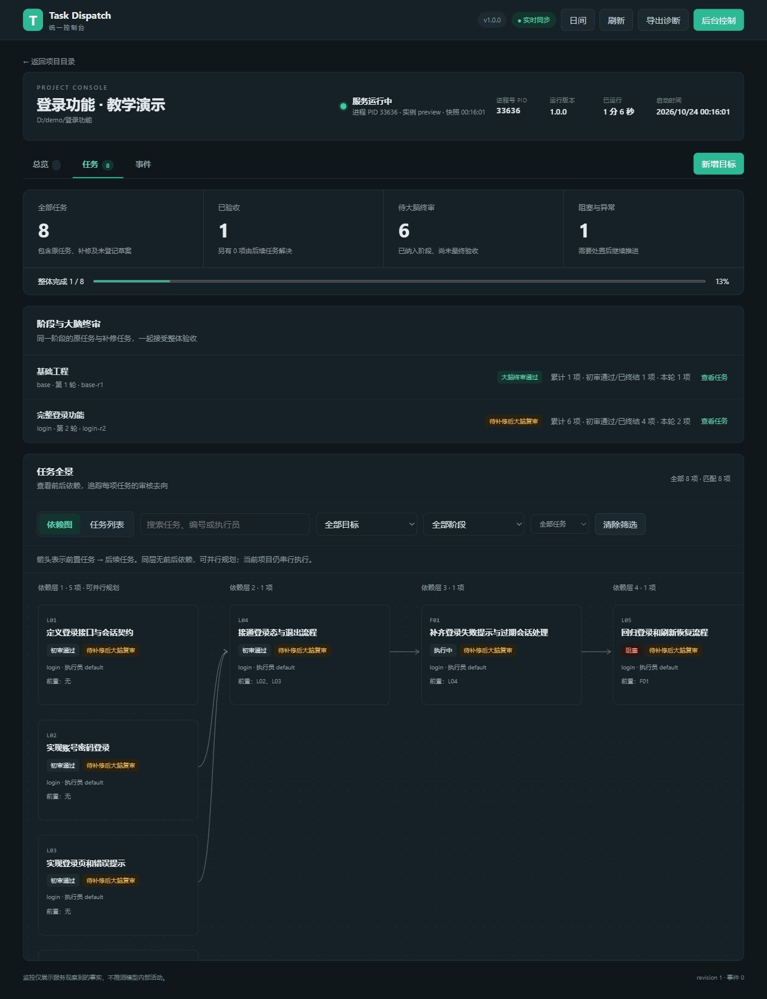

<div align="center">

# Task Dispatch

**让不同 AI 会话组成一支有分工、有审核、能持续交接的开发团队。**

大脑负责规划与终审 · 初审端逐项把关 · 执行员完成实现

本地运行 · 跨平台会话协作 · 可视化任务看板 · 目标队列

[快速上手](#快速上手) · [项目亮点](#项目亮点) · [支持平台](#支持平台) · [文档导航](#文档导航)

**v1.0.0** · **Node.js 22+**（OpenCode 需 22.13+）· **运行时无第三方 npm 依赖**

</div>

Task Dispatch 是面向游戏与应用开发的任务分派 Skill 和本地协作运行时。你提出目标、邀请自己的 AI 会话加入并点击开始，服务负责在角色之间交接任务、保留审核证据，并把进度呈现在同一个 Web 控制台中。

适合把强模型放在规划、复杂决策与整体验收上，把边界明确的实现与初审交给合适的模型。平台与模型由你在各自会话中选择；Task Dispatch 负责协作流程。

## 项目亮点

| 能力 | 对实际开发有什么帮助 |
| --- | --- |
| **不同平台，同一支团队** | Codex、MiMo、Qoder/QoderCN、OpenCode、CodeArts、DSH 的现有会话可以承担不同角色，在同一个项目中交接。 |
| **按能力分工** | 默认“大脑＋初审端＋一名执行员”；支持多个执行员编号、能力标签与职责，任务可定向派给匹配成员。 |
| **逐项初审，整阶段终审** | 初审端先检查每项实现，大脑再验收完整功能。终审发现问题后追加关联修复任务，保留原任务与修复轮的证据。 |
| **目标排队，成员复用** | 同一目录沿用项目、团队和会话绑定。新目标经你明确开始后加入队列，当前目标验收完成再继续下一个。 |
| **看得见依赖与阻塞** | Web 控制台集中展示项目、成员、任务依赖图、阶段结论和事件；能定位“等待谁”“卡在哪一步”。 |
| **原会话唤醒与续接** | 支持的平台通过原会话接收交接通知。状态持久化，恢复时按原任务继续；通知送达、实际领取和结果提交分别记录。 |
| **结果有证据** | 保存候选快照、审核回执、修复关联与配置的验证报告；展示已观测用量，未知用量明确标记。 |

**当前协作范围：同一台机器、同一个项目工作目录。** 单项目内的执行与审核串行调度；多个执行员用于职责与能力分工。目标创建和成员接入只做准备，全部就绪后由用户点击「开始」。

## 一次协作如何完成


| 角色 | 负责什么 |
| --- | --- |
| **大脑 / brain** | 拆解目标、安排依赖与执行员、登记阶段、处理阻塞、整体验收和目标收尾。 |
| **初审端 / reviewer** | 按任务契约只读初审，发现问题退回执行员，初审通过后等待阶段终审。 |
| **执行员 / worker** | 领取指定任务，只修改授权范围内的文件，提交产物与验证结果，按反馈返修。 |

例如开发登录功能：先拆出接口、页面和登录态处理，逐项实现并初审，最后由大脑检查完整的登录、退出和异常路径。**初审通过不等于最终验收**；修复后仍需重新接受阶段终审。

## 快速上手

下面以 Windows 的 Web 控制台为主线。先准备 Node.js 22+，以及三个独立的 AI 会话；三个角色可以来自同一平台，也可以混用不同平台。各会话需要能执行本地命令，并在宿主中打开**同一个项目目录**。

*以下截图来自真实控制台前端，使用隔离演示数据，不包含真实项目、凭据或模型调用记录。点击图片可查看大图。*

### 1. 获取项目并安装 Skill

```powershell
git clone https://github.com/wjzhaoo/task-dispatch.git
cd task-dispatch

# 按你使用的平台安装，也可以用逗号指定多个
node scripts/install.js codex
node scripts/install.js codex,mimo,qoder,opencode
```

Windows 也可以双击 `install.bat`，输入平台名称；直接回车安装到全部五个安装目标。安装到 Qoder/QoderCN 后重启宿主，让桥接插件加载。

无需 `npm install`。安装器复制 Skill 并生成指向本仓库客户端的 `runtime-link.json`，不启动服务，也不配置模型或 API Key。**请保留仓库目录；移动后重新运行安装命令。**

### 2. 打开控制台，填写目标

在仓库目录双击 `dashboard.bat`，或运行：

```powershell
node runtime/web-console.cjs
```

启动器会打开浏览器，默认端口为 **43187**；占用时自动顺延，已有控制台则复用。主页点击「创建目标」，填写三个字段：

| 字段 | 示例 |
| --- | --- |
| 目标名称 | 完成游戏存档功能 |
| 项目工作目录 | `D:\projects\game-demo`（替换成你已有的项目绝对路径） |
| 目标与验收要求 | 支持手动保存与继续游戏；重启后恢复进度；存档损坏时给出提示；已有功能无回归。 |



默认三名成员即可开始。需要不同职责的执行员时，展开「高级成员设置」，填写编号、能力标签与职责。点击「创建目标」后，目标保持**待开始**。

### 3. 邀请大脑、初审端和执行员

进入项目的「总览」，在「项目成员」中为缺少的角色点击「复制加入邀请」，选择接收会话的真实平台，把生成的提示词原样粘贴到对应会话。



三个成员可以同时接入，顺序不限。邀请包含项目与角色信息，接收端按提示完成身份核验、保存独立凭据并待命。Web 已保存成员配置，大脑无需再次配置团队或生成其他成员邀请。

等「已就绪」达到 **3 / 3** 后，再开始目标。仅在终端中 `cd` 不等于宿主已打开正确工作区；出现接入问题时，先核对三个会话实际打开的项目目录。

### 4. 点击开始，持续追加目标

在目标卡片点击「开始」，大脑开始规划阶段并派发任务。进入「任务」页签，可以查看依赖关系、初审状态与阶段终审结论；「事件」页签用于追踪交接与异常。

<details>
<summary>查看完整任务看板截图：依赖关系、阶段终审与补修进度</summary>



</details>

后续点击「新增目标」，沿用现有成员。新目标先保存为待开始；已有活动目标时，点击「加入队列」才会排队执行。


当前目标由大脑明确完成验收后，服务继续下一个已授权目标；队列为空时保留成员待命。需要处理阻塞、换绑会话或恢复服务时，参阅[统一 Web 控制台](docs/admin-console.md)与[服务发现与接入](skills/task-dispatch/references/connection.md)。

### 只想先体验规划？

安装后新建对话，输入：

```text
使用 $task-dispatch，为当前项目规划登录功能。
先只输出任务拆分、各角色职责、依赖关系和验收要求，暂不执行。
```

也可以要求生成手动交接包。没有外部模型接口时，Skill 会输出可转交的任务说明；自动协作需要按上面的步骤实际接入各角色。OpenCode 可使用 `@task-dispatch`，其他不支持 `$` 调用的宿主可要求读取安装目录中的 `SKILL.md`。

## 支持平台

Skill 安装目标与运行时接入平台分别如下。大脑、初审端和执行员均可使用下表中的六种运行时平台。

| 平台 | 安装或接入方式 | 会话接入说明 |
| --- | --- | --- |
| Codex | `node scripts/install.js codex` | 显式使用 `--provider codex` 后读取当前 `CODEX_THREAD_ID`；[桌面接入](skills/task-dispatch/references/desktop.md)。 |
| MiMo | `node scripts/install.js mimo` | 使用真实会话 ID 与原会话唤醒；[接入说明](docs/mimo-wake-integration.md)。 |
| Qoder / QoderCN | `node scripts/install.js qoder` / `qodercn` | 安装 Skill 与 App Plugin 桥接，重启宿主后生效；两者 provider 均为 `qoder`；[接入说明](skills/task-dispatch/references/qoder.md)。 |
| OpenCode 2.x | `node scripts/install.js opencode` | 需 Node.js 22.13+、真实 `ses_...` 会话 ID、可读会话数据库和官方 CLI；[接入说明](skills/task-dispatch/references/opencode.md)。 |
| CodeArts | 已有独立 Hook bridge 环境 | 使用 `--provider codearts`，不在一键安装目标中；[接入说明](skills/task-dispatch/references/codearts.md)。 |
| DSH / DeepSeek Harness Desktop | 本机 Remote API | 使用 `--provider dsh`，不在一键安装目标中；[接入说明](skills/task-dispatch/references/dsh.md)。 |

其他合法 provider 仅可接入执行员，使用持续 `wait` 模式。原会话自动唤醒依赖宿主支持与真实身份核验，具体条件以各平台文档为准。

<details>
<summary>展开查看安装目录与常用入口</summary>

| 安装目标 | 用户目录下的 Skill 位置 |
| --- | --- |
| `codex` | `.codex/skills/task-dispatch` |
| `mimo` | `.config/mimocode/skills/task-dispatch` |
| `qoder` | `.qoder/skills/task-dispatch` |
| `qodercn` | `.qoder-cn/skills/task-dispatch`（兼容别名 `qoder-cn`） |
| `opencode` | `.config/opencode/skills/task-dispatch` |

Qoder/QoderCN 的桥接分别位于 `.qoder/app/dev-extensions/task-dispatch-bridge` 与 `.qoder-cn/app/dev-extensions/task-dispatch-bridge`。

| 入口 | 用途 |
| --- | --- |
| `install.bat` | Windows 交互安装；直接回车安装全部五个目标。 |
| `dashboard.bat` / `web-console.bat` | 打开统一 Web 控制台。 |
| `start.bat` | 桌面客户端命令包装，如 `connect`、`resume`、`status`；双击查看常用命令。 |
| `dashboard.bat --cli` | 原命令行管理菜单。 |

</details>

## 本地数据与恢复

每个项目默认把状态、快照、审核副本和角色凭据保存在自己的 `.task-dispatch/runtime/<项目路径摘要>/` 中；该运行目录由局部 `.gitignore` 与快照策略排除。系统目录只登记项目路径映射，不保存角色令牌。

服务重启保留队列、开始授权与已登记状态。会话恢复优先使用 `resume`，换人使用管理台的改绑邀请；结构不完整的旧数据会明确拒绝加载。修改运行时代码后，需在安全边界重启服务，已安装 Skill 的更新也需重新运行安装器。

## 文档导航

| 你想做什么 | 阅读 |
| --- | --- |
| 查看控制台全部操作、目标队列与排障 | [统一 Web 控制台](docs/admin-console.md) |
| 接入会话、理解首次连接与续接 | [服务发现与接入](skills/task-dispatch/references/connection.md) · [桌面客户端](skills/task-dispatch/references/desktop.md) |
| 配置多个执行员、定向派单与交接 | [多执行员接入](skills/task-dispatch/references/workers.md) |
| 了解阶段计划、完整功能终审与修复轮 | [阶段计划与终审](skills/task-dispatch/references/stages.md) |
| 配置独立验证、检查产物与审核证据 | [独立验证环境](docs/review-validation.md) · [证据校验示例](examples/evidence-validation/README.md) |
| 管理快照、缓存、尝试额度与用量 | [存储与消耗](docs/storage-usage.md) · [尝试预算](docs/attempt-budgets.md) |
| 查看运行配置、恢复规则与已知问题 | [运行文档](docs/runtime.md) · [服务健康排查](docs/service-health-audit.md) |
| 查看版本变化 | [CHANGELOG](CHANGELOG.md) · [版本源文件](VERSION) |

## 升级与开发验证

更新仓库后，再次运行对应平台的安装命令。安装器按内容判断变更；发现已安装文件被手动修改且与新版冲突时，会停止并指出路径，不直接覆盖。用户额外添加的文件会保留。

```powershell
# 安装预览，不写入真实技能目录
node scripts/install.js codex --dry-run

# 运行时回归
npm test

# 安装、重复安装、升级和冲突保护验证
node scripts/verify.js

# 用正式前端资源打开隔离演示，不连接真实调度或模型
node scripts/task-board-preview.cjs
```

安装验证使用系统临时目录，结束后打印并保留目录供检查。演示脚本会输出本地地址，可浏览任务看板、目标队列和成员接入界面；演示中的写入操作不会提交。

`.codex-plugin/plugin.json` 同时保留原生插件封装入口。本文的一键安装采用 Skill 复制方式，无需同时进行两种安装。
