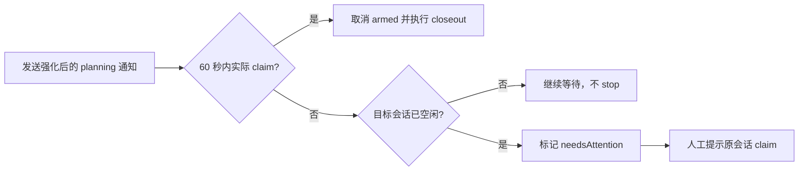

# 计划：防止 MiMo 唤醒后只展示领取命令

> **B 模型开工指令**：阅读 `docs/plans/2026-09-14-MiMo唤醒后未领取任务.md` 并严格执行。

## 0. 执行者须知（写给 B 模型）

1. 本文档自包含全部上下文，不依赖任何会话历史。
2. 按任务顺序执行；每完成一项，将状态改为 `[x]` 并在“结果”栏一句话记录。
3. 现场代码与本文档描述冲突时，停下询问用户，禁止自行发挥。
4. 只做第 4 节任务清单内的事；其他可改进项只写入第 7 节。
5. 受第 5 节保护的内容不得修改。

## 1. 背景与目标

- 为什么做：MiMo 收到 planning 唤醒后，只输出了 `claim` 命令文本便结束回合，实际未领取收尾待办。通知已记为 `sent`，会让 planning 持续滞留。
- 完成后的可观察效果：Codex、MiMo 和 CodeArts 共用的唤醒通知明确要求实际调用终端工具，不得只展示命令；planning 通知送达后长时间无人领取且目标会话已空闲时，记为 `needsAttention`，不自动 stop，也不盲目重发。

## 2. 现状锚点（B 模型必读）

| 位置 | 现状 | 作用 |
|------|------|------|
| `runtime/core/wake.cjs` L87 | 普通任务通知只说“执行 claim”，未禁止仅输出命令 | 本计划修改对象 |
| `runtime/core/wake.cjs` L93-L111 | planning 通知送达后遇到 `status=sent` 直接返回，未检查是否实际 claim | 本计划修改对象 |
| `runtime/core/wake.cjs` L129 | scope 通知同样未禁止仅输出操作文本 | 本计划修改对象 |
| `runtime/core/desktop.cjs` L123-L131 | brain 实际 claim planning 时会将 `armed` 置为 false | 只读依赖，可用于判断未领取 |
| `tests/planning.test.cjs` L58-L61 | 已验证 planning 通知只发一次与 uncertain 不重发 | 补充回归断言 |

- 构建/验证方式：项目根目录执行 `npm test` 和 `npm run verify:skill`。

## 3. 方案与关键决策

### 方案 A：仅强化提示

- 思路：只修改三类唤醒文案，明确“立即调用终端工具实际执行，不得仅展示或复述命令”，并要求原样复用已有路径。
- 影响面：最小，仅提示词。
- 回归风险：低；但模型仍可不遵守，失联时仍无状态提示。

### 方案 B：强化提示 + planning 未领取看门狗（推荐）

- 思路：在方案 A 基础上，planning 通知 `sent` 超过 60 秒、brain 仍为 `armed`，且目标会话已空闲时，设置现有 `planning.needsAttention=true` 并记录 `planning_stalled` 事件。
- 影响面：`runtime/core/wake.cjs` 和 `tests/planning.test.cjs`；复用现有字段与事件，不新增对外接口或数据结构。
- 回归风险：低到中；慢于 60 秒才执行 claim 的空闲会话可能被标记需人工关注，但不会自动取消、重发或破坏待办。
- 推荐理由：同时降低复发率并提供可观测的失联状态，且不引入高风险 `stop`。

- 决策记录：
  - 用户已于 2026-09-14 22:06 输入 `1` 选定方案 B，因为它覆盖已观察到的“通知送达但未领取”失联场景。
  - 否决自动 `stop`，因为它可能与刚唤醒的新回合竞态，且不同平台的取消语义不一致。
  - 否决自动重发，保持现有去重和不盲目重试边界。

## 4. 任务清单

### T1 强化共用唤醒指令并增加 planning 未领取检测

- 文件：`runtime/core/wake.cjs`
- 改动：
  - 修改普通任务、planning 和 scope 三类通知，明确要求立即调用终端/命令工具实际执行，禁止仅输出命令。
  - 提醒执行者原样复用当前会话已有的 client、credential 和 data 路径，不凭记忆重写。
  - planning 通知送达 60 秒后，若 brain 仍 `armed` 且会话空闲，使用现有 `needsAttention` 和 `planning_stalled` 机制标记；不 stop、不重发。
- 验收：通知文本具备上述强制语义；超时且空闲的未领取 planning 被标记，正在忙或已 claim 的会话不被误标记。
- 结果：已强化三类通知文案，并对送达超过 60 秒、brain 仍 armed、会话空闲的 planning 设置现有 `needsAttention` 和 `planning_stalled`。
- 状态：[x] 已完成

### T2 补充回归测试

- 文件：`tests/planning.test.cjs`
- 改动：断言通知要求实际工具执行；模拟过期已送达通知，验证空闲未 claim 标记 `needsAttention`、忙碌状态不标记、不重发。
- 验收：新用例修复前失败、修复后通过；原有唤醒去重与 uncertain 测试仍通过。
- 结果：已断言强制执行文案，并覆盖忙碌不误标、空闲超时标记、已 claim 不误标及不重发。
- 状态：[x] 已完成

## 5. 约束

- 禁止修改：`runtime/adapters/` 、平台 stop/cancel 接口、通知重发策略、对外协议与数据结构。
- 代码标记：新增代码加 `[AI-added]` 及精确到分钟的日期，注释不含中文。
- 编码：保持现有 UTF-8 无 BOM。
- 边界：不读取或引用任何历史任务记录；仅更新本任务文档。

## 6. 整体验证

- 构建命令：`npm test`
- 测试/运行命令：`node --test tests/planning.test.cjs tests/wake.test.cjs tests/storage-usage-mimo.test.cjs`；`npm run verify:skill`
- 用户提供的验证方法：无。
- 通过标准：所有命令退出码为 0；新回归断言通过；无 stop 或重发行为变更。

## 7. 执行备注（B 模型回写）

- 定向回归 22/22 通过；全量测试 84/84 通过；`npm run verify:skill` 通过。
- 保持既有送达去重边界，未新增 stop/cancel 或自动重发。

## 生成/修改记录

| 时间 | 模型 | 操作 | 摘要 |
|------|------|------|------|
| 2026-09-14 22:01 | GPT-5 | 创建 | 初版，推荐强化提示并增加 planning 未领取看门狗 |
| 2026-09-14 22:06 | GPT-5 | 更新 | 记录用户选定方案 B |
| 2026-09-14 22:09 | GPT-5 | 更新 | 回写任务完成状态与验证结果 |
