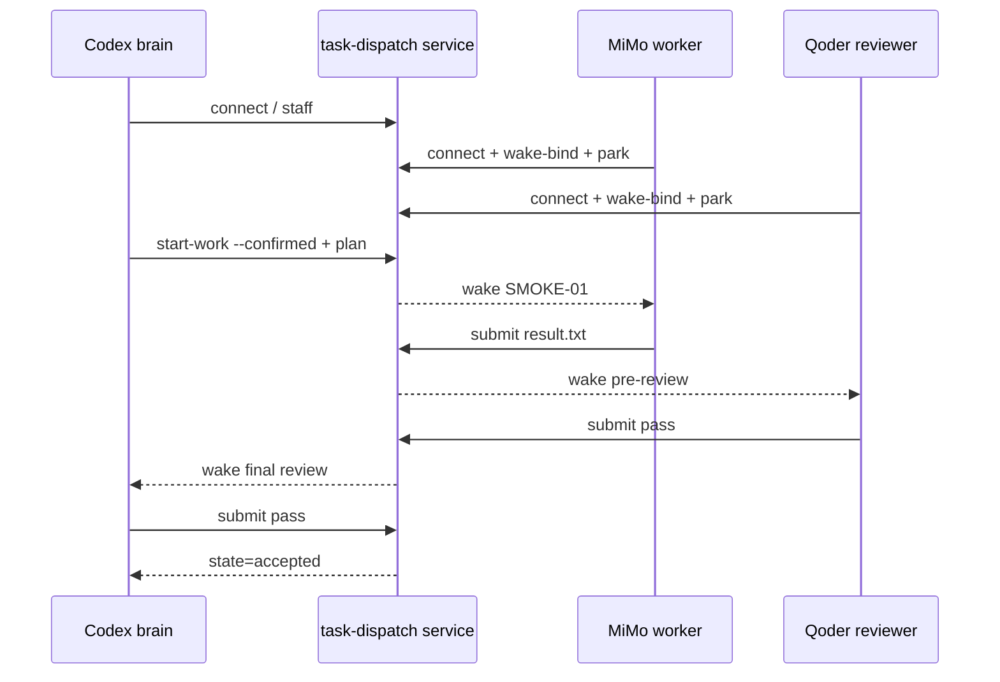

# 计划：Codex 大脑 + Qoder 小脑 + MiMo worker 三端极简联调

> 用户审阅本计划并再输入一次 `1` 后执行。

## 0. 执行者须知

1. 本次只验证 task-dispatch 的三端接入、wake/park、派单、初审和终审闭环，不修改 task-dispatch 业务代码。
2. 大脑平台为 Codex，小脑平台为 Qoder，worker 平台为 MiMo。
3. 所有测试文件放在当前工作区 `tmp/three-role-smoke-20260915/`，不访问其他项目。
4. 任何 IDE 缺失、Hook 未安装、会话无法唤醒或出现权限对话框时，记录真实阻塞，不伪造成功、不改用其他平台。
5. 不读取未授权的历史 `docs/logs/`、`docs/plans/` 或总结。

## 1. 背景与目标

- 用一个几乎不需要推理的文本文件任务，隔离“模型思考耗时”，专门观察三端连接、唤醒和角色流转是否稳定。
- 成功闭环：Codex brain 建立项目和任务 → MiMo worker 创建固定内容文件 → Qoder reviewer 只读初审 → Codex brain 终审 → 任务 `accepted`。

## 2. 测试契约

| 项目 | 固定值 |
| --- | --- |
| 测试目录 | `tmp/three-role-smoke-20260915/` |
| 任务 ID | `SMOKE-01` |
| worker ID | `mimo-worker` |
| 允许修改 | `result.txt` |
| 要求内容 | 单行 `task-dispatch smoke ok`，UTF-8 无 BOM |
| 验收命令 | PowerShell 精确比较文件文本，并检查无 BOM |

## 3. 方案与关键决策

### 方案 A：真实三 IDE 原会话唤醒（推荐，用户已指定）

- 通过桌面操作将 reviewer 邀请交给 Qoder、worker 邀请交给 MiMo，三端都使用各自的真实会话。
- 优点：能直接复现用户关心的断流/唤醒现象。
- 风险：Qoder Hook 或 MiMo 本地 API 若未就绪，测试会在连接阶段停止；这本身就是有效诊断结果。

### 方案 B：完全本地模拟三角色

- 使用测试适配器模拟 brain/reviewer/worker，不操作真实 IDE。
- 优点：快速稳定；风险：无法验证今日出现的原会话断流，不适合本次目标。

- 决策：采用方案 A。

## 4. 任务清单

### T1 建立隔离测试项目与 Codex brain

- 改动：创建临时目录和极简项目规则，以当前 Codex 会话连接 brain，登记一名 `mimo-worker`。
- 验收：status 显示项目工作区正确、brain 绑定到当前 Codex 会话、startup 仍为 waiting。
- 结果：前置检查发现当前 Codex 会话 cwd 是主仓库，与临时项目不一致，无法通过 wake 工作区校验；等待用户决定是否在三个 IDE 中打开临时目录。
- 状态：[ ] 未开始

### T2 接入 Qoder reviewer 与 MiMo worker

- 改动：在真实 Qoder 和 MiMo 会话中分别执行邀请命令，校验平台、session ID、工作区、wakeEnabled 和 armed；两端就绪后再启动工作。
- 验收：Qoder reviewer 与 MiMo worker 均是独立凭据，provider 与用户指定一致，唤醒端必须实际 park。
- 结果：前置检查确认 Qoder CN 与 MiMo 进程在运行；MiMo API 可达且主仓库有 1 个匹配会话，临时目录无匹配会话；Qoder Hook 文件和 bridge 目录缺失，无法发现或唤醒 Qoder reviewer。
- 状态：[ ] 未开始

### T3 启动并执行 `SMOKE-01`

- 改动：沿用用户已给出的“开始”授权执行 `start-work --confirmed`，再 plan 固定文本任务；不代替 MiMo worker 写入文件。
- 验收：MiMo worker 被唤醒、领取、写入并 submit；候选只包含 `result.txt`。
- 结果：待执行。
- 状态：[ ] 未开始

### T4 完成 Qoder 初审与 Codex 终审

- 改动：Qoder 只读检查文件和证据后提交初审；Codex 领取终审，核对产物并提交结论。
- 验收：任务到达 `accepted`，且 execution/reviewer/brain 尝试各一次；若任何端断流，记录断在哪一步和状态字段。
- 结果：待执行。
- 状态：[ ] 未开始

### T5 收尾、记录与清理

- 改动：完成 planning closeout/项目结束，写入测试总结；在确认服务已结束、没有活跃 wait/唤醒监听后，清理本任务创建的 `tmp/three-role-smoke-20260915/`。
- 验收：总结包含每段耗时、provider、wake/armed、任务状态与失败证据；不残留测试 wait 进程。
- 结果：待执行。
- 状态：[ ] 未开始

## 5. 约束

- 不修改 task-dispatch 源码、已安装 Skill 或 IDE 全局配置；若 Qoder Hook 缺失，停下报告，不自行安装。
- 不读取/输出凭据 token、不扫描 IDE 数据库、不按时间或标题猜会话。
- 只允许 MiMo worker 修改测试项目的 `result.txt`；Qoder reviewer 和 Codex brain 只读候选。
- 如果需要修改工作区外文件或安装 Hook，先询问用户。

## 6. 整体验证

- 文件内容精确为 `task-dispatch smoke ok` 加换行，UTF-8 无 BOM。
- 服务 status 显示：
  - brain provider = `codex`。
  - reviewer provider = `qoder`。
  - `worker:mimo-worker` provider = `mimo`。
  - `SMOKE-01.state = accepted`。
- 尝试数预期：execution = 1，review = 2，total = 3；若不符，解释重试/断流原因。
- 记录邀请生成、attach/park、plan、worker submit、reviewer pass、brain pass 的时间点。

## 7. 执行备注

- 用户已将“coder”确认为 Qoder，并已给出“开始”授权。
- 额外验证方法：未提供，使用本计划第 6 节的确定性检查。
- 2026-09-15 20:00 环境前置检查：当前工具未暴露原生 app 操作面，无法直接向 Qoder/MiMo 窗口粘贴邀请；Qoder 已安装包中缺少新版 `qoder-hook.cjs`，修复需修改工作区外的用户 IDE 配置并重启 Qoder，须先取得用户明确授权。

## 生成/修改记录

| 时间 | 模型 | 操作 | 摘要 |
| --- | --- | --- | --- |
| 2026-09-15 19:54 | GPT-5 | 创建 | 建立 Codex/Qoder/MiMo 真实三端极简联调计划 |
| 2026-09-15 20:00 | GPT-5 | 更新 | 记录 Codex cwd、Qoder Hook 和原生 UI 操作前置阻塞 |
