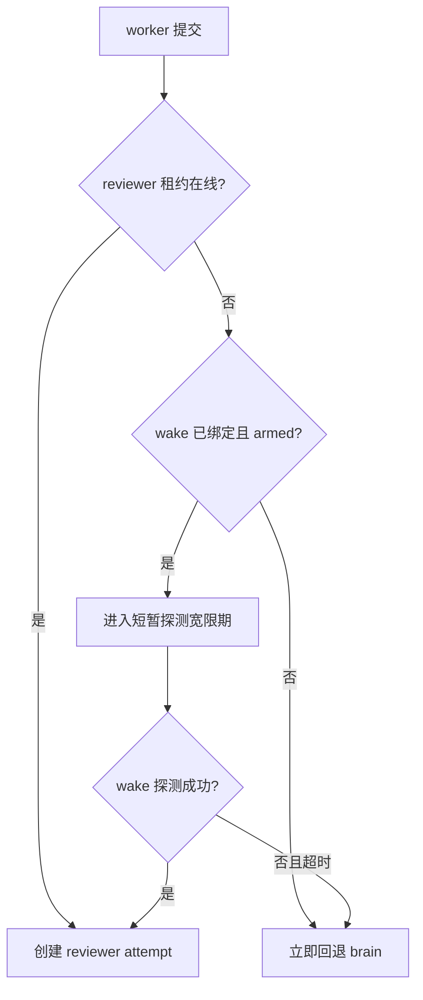

# 计划：修复 reviewer 在线租约与审核即时调度竞态

> 用户审阅通过并输入 `1` 后执行。执行者必须以当前代码为准，严格限制在本计划范围内。

## 0. 执行者须知

1. 本文档自包含本次修复上下文，不引用 `docs/logs/`、其他 `docs/plans/` 或历史总结。
2. 按任务顺序执行；每完成一项，将状态改为 `[x]` 并填写结果。
3. 现场代码与本计划冲突时停止并询问用户，不自行扩大范围。
4. 只修改第 4 节列出的文件；发现旁支问题仅记录，不顺手修改。
5. 所有代码新增内容添加 `[AI-added]` 与精确到分钟的日期，注释不含中文。

## 1. 背景与目标

- 现象：worker 提交候选后，小脑 reviewer 没有被唤醒；实时状态显示审核 attempt 在提交后约 42ms 内直接创建为 `role=brain`。
- 根因：reviewer 在线状态采用 120 秒内存租约；worker `submit` 会立即同步执行调度。当租约恰好过期，而已绑定并 park 的 reviewer 尚未来得及由 wake 探测刷新时，调度器立即且不可逆地回退 brain。
- 目标：对于已配置 wake 且 `armed=true` 的 reviewer，租约失效时先保留一个短暂探测窗口；wake 探测确认可达后派给 reviewer，窗口结束仍不可达才回退 brain。
- 不改变：120 秒正常心跳租约、无 wake reviewer 的回退规则、审核中的离线回收规则、worker 必须 park 才允许唤醒的安全语义。

## 2. 现状锚点

| 位置 | 现状 | 作用 |
| --- | --- | --- |
| `runtime/core/pre-review.cjs` | `online()` 只检查 120 秒内存时间戳；无探测宽限状态 | 本计划主要修改对象 |
| `runtime/core/dispatcher.cjs` L252-L285 | `tick()` 找到 `review_ready` 后立即执行，`execute()` 一次性决定 reviewer/brain | 接入延迟判断 |
| `runtime/core/wake.cjs` L58-L70 | 每轮异步读取 reviewer wake 会话并调用 `touch()` | 保持现有探测机制 |
| `runtime/core/desktop.cjs` L174-L196 | worker 提交后立即调用 `d.tick()` | 竞态触发点，原则上只读 |
| `tests/pre-review.test.cjs` | 已覆盖在线、离线和审核中掉线，未覆盖“租约刚过期但 wake 会话可达” | 补充回归测试 |

- 构建/验证方式：见 `PROJECT.md`，在项目根目录运行 Node.js 测试。

## 3. 方案与关键决策

### 方案 A：调度前增加内存探测宽限期（推荐）

- 当任务为 `review_ready`、reviewer 已配置 wake 且 `armed=true`、但当前租约不在线时，首次调度只记录短暂的内存探测截止时间并暂缓创建审核 attempt。
- 正常 `wake.run()` 在窗口内探测 reviewer；成功后 `touch()`，下一轮调度派给 reviewer。
- 探测窗口到期仍未在线，则按原行为派给 brain。
- `touch()` 后清理对应探测状态；服务重启后重新建立短暂窗口，不信任旧在线租约。

影响面：`pre-review` 在线判定辅助逻辑、`dispatcher` 的 `review_ready` 选择、相关测试。

回归风险：审核可能最多延迟一个很短的探测窗口；若窗口状态未按 reviewer client 隔离，换绑后可能错误复用，因此 key 必须包含当前 reviewer clientId。

### 方案 B：调整全局循环为先 `wake.run()`、再 `dispatcher.tick()`

- 每个服务周期先等待全部外部唤醒适配器读取完成，再调度。

影响面：服务主循环和所有项目调度时延。

回归风险：单个适配器超时会拖慢所有项目；且 `submit()` 内部仍会直接 `d.tick()`，不能单独消除竞态。故不推荐。

### 方案 C：只要 reviewer 有 wake 且 armed 就视为在线

- 不再要求 120 秒租约。

影响面：审核路由安全语义。

回归风险：关闭的 reviewer 或服务重启前遗留的 armed 状态会让审核卡死；违反“不信任陈旧绑定”的设计。否决。

### 决策

- 推荐方案 A：局部、可测试、保留离线回退，并同时覆盖服务重启和即时提交场景。
- 用户已于 2026-09-15 14:13 输入 `1`，确认执行方案 A。

## 4. 任务清单

### T1 增加 reviewer 探测宽限状态

- 文件：`runtime/core/pre-review.cjs`
- 改动：封装“是否需要等待一次 wake 探测”的判断；使用进程内 Map，按项目和 reviewer clientId 隔离；`touch()` 成功后清理等待状态；提供测试可控的短窗口常量或时间入口。
- 验收：无 wake 或未 armed 的 reviewer 不等待；wake+armed 且租约刚失效时等待；超时后允许回退；换绑不复用旧状态。
- 结果：新增 15 秒进程内探测窗口，按项目与 reviewer clientId 隔离；有效 `touch()` 会清理探测状态。
- 状态：[x] 已完成

### T2 在审核调度前应用宽限判断

- 文件：`runtime/core/dispatcher.cjs`
- 改动：选择 `review_ready` 任务时，若 reviewer 正处于探测窗口则暂不创建 attempt；其他 ready 任务的串行、依赖和预算语义保持不变。
- 验收：worker 提交后不会在 wake 刷新前立即产生 brain attempt；探测成功后产生 reviewer attempt；不可达超时后产生 brain attempt。
- 结果：`review_ready` 执行前应用探测判断；窗口内保持待审，成功续租后派 reviewer，超时后回退 brain。
- 状态：[x] 已完成

### T3 补充竞态与回退测试

- 文件：`tests/pre-review.test.cjs`
- 改动：新增至少两组测试：①租约过期但已 park 且适配器可达，先暂缓、刷新后派 reviewer；②适配器持续不可达，宽限到期后回退 brain。保持现有“无 wake 立即回退”和“审核中掉线回收”测试通过。
- 验收：新测试在修复前可复现失败，修复后通过；现有相关测试无回归。
- 结果：新增可达续租与超时回退两条测试，并让测试夹具在结束时清理临时目录。
- 状态：[x] 已完成

## 5. 约束

- 禁止修改：`docs/summaries/` 中既有历史总结、`docs/logs/` 中其他任务日志、`docs/plans/` 中其他计划、适配器协议、凭据和服务状态文件。
- 不改变 worker 的 park/armed 规则；首次 worker 未唤醒属于未进入有效待命或目标非 idle，本修复不通过自动 armed 绕过安全边界。
- 不修改 CMake、头文件或外部工作空间。
- 保持 CommonJS 风格和现有 Node.js 兼容范围。
- 代码新增内容必须带 `[AI-added] 2026-09-15 HH:mm` 英文注释。

## 6. 整体验证

- 定向测试：`node --test tests/pre-review.test.cjs tests/wake.test.cjs`
- 全量测试：`npm test`
- 通过标准：新增竞态/回退测试通过；相关现有测试通过；全量测试不新增失败。
- 已知基线：当前全量测试 111 项中 110 通过，`release version is consistent across distribution metadata` 因 `0.4.3 !== 0.5.1` 失败，与本修复无关，不在本计划中顺带修改。
- 用户现有复现标准：worker 提交时 reviewer 的 120 秒租约即使刚过期，只要已 park 且会话可达，审核应进入 reviewer，而不是直接创建 brain attempt。

## 7. 执行备注

- 当前实时项目已生成的 `role=brain` attempt 不在本次代码修复中强制迁移；修复针对后续调度。若需处置现有 attempt，应另行确认运行状态变更。
- 未读取任何检测到的历史总结内容。
- 定向测试 13/13 通过；全量测试 113 项中 112 通过，唯一失败为既有版本元数据不一致。

## 生成/修改记录

| 时间 | 模型 | 操作 | 摘要 |
| --- | --- | --- | --- |
| 2026-09-15 14:07 | GPT-5 | 创建 | 建立 reviewer 在线租约竞态修复计划 |
| 2026-09-15 14:13 | GPT-5 | 更新 | 记录用户确认方案 A |
| 2026-09-15 14:17 | GPT-5 | 更新 | 完成实现并回写验证结果 |
