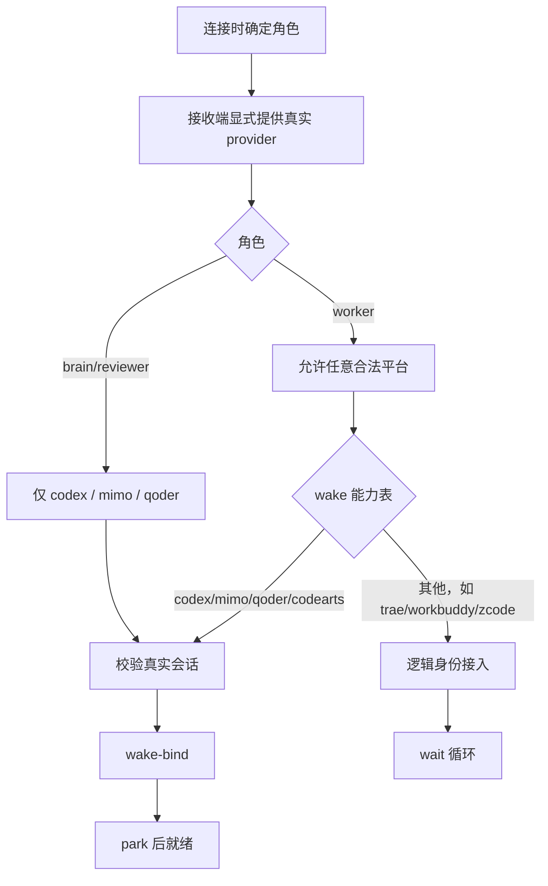

# 计划：治理大脑/小脑断流并收口角色平台接入

> 用户已于 2026-09-15 明确要求执行，并于 2026-09-16 再次确认：去掉平台自动识别，`connect/rebind` 必须由接收端显式提供真实 `--provider`，避免唤醒适配器跑偏。

## 0. 执行者须知

1. 本文档自包含全部上下文，不依赖历史对话。
2. 按任务顺序执行；每完成一项，将状态改为 `[x]` 并填写“结果”。
3. 现场代码与本计划冲突时停下询问用户，不得自行扩大范围。
4. 不读取未获用户授权的历史计划、日志或总结；本计划只引用用户明确指定的 `docs/summaries/2026-09-15-执行员接入耗时长诊断.md`。
5. 代码新增或改写逻辑保留原实现注释，新代码使用 `[AI-added] YYYY-MM-DD HH:mm` 英文注释。

## 1. 背景与目标

- 今日实测出现多次大脑/小脑断流、大脑未被唤醒、worker 接入长时间停在“连接中”。
- 目标是去掉“120 秒无请求即小脑离线”的误判，收口平台能力与角色限制，并要求接收端显式指定真实平台；系统不从邀请、目录或其他 IDE 猜测 provider。
- 完成后的可观察效果：
  - brain/reviewer 只允许 `codex` / `mimo` / `qoder`，且必须成功绑定唤醒后才就绪。
  - worker 平台不限；`codex` / `mimo` / `qoder` / `codearts` 走 wake，`trae` / `workbuddy` / `zcode` 及其他显式平台走 wait。
  - wait worker 不再为了获取无用的 IDE 真实 session ID 而空转。
  - 已领取的 reviewer 审核不因 120 秒未 heartbeat 被撤销；真实关闭/断绑/唤醒失败仍有可恢复路径。

## 2. 现状锚点与根因

| 位置 | 现状 | 判定 |
| --- | --- | --- |
| `runtime/core/pre-review.cjs:2-38` | reviewer 在内存中使用 `LEASE_MS = 120000`；超时后会把未结算审核标为 `reviewer_offline` 并改派 brain | 把“没有调用服务”误当成“IDE 关闭”，长审核或唤醒短暂不可读时会断流 |
| `runtime/core/contracts.cjs:39` | 提示 reviewer 每分钟 heartbeat/progress | heartbeat 成为正确性前提，宿主中断一次即可产生误离线 |
| `runtime/core/session-discovery.cjs:10-29` | 依靠固定 provider 集合跨 IDE 搜索邀请标记；当前源码已增加 Qoder，但 wait IDE 仍无发现通道 | 对 wait worker 要求真实 session ID 没有价值，是接入空转的直接来源 |
| `runtime/core/continuation.cjs:12-39` | wake 白名单仍是 `codex/mimo/codearts`，Qoder 由客户端特判二次绑定；未支持平台默认 wait | 平台能力定义分散，容易出现选择、提示词和停止方式不一致 |
| `runtime/desktop-client.cjs:14-28,49-57,139-178` | 邀请是通用文案；连接时根据环境变量/自动发现决定 provider，Qoder 再由专用分支修正 | 当环境变量缺失或自动发现不完整时，会生成错误的 resume/park/wait 行为 |
| `runtime/wizard.cjs:65,93-101` | 菜单 9 只输出通用大脑/执行员说明，没有询问 reviewer，也没有按角色选平台 | 连接前缺少唯一、显式的平台决策点 |
| `runtime/server.cjs:17` | 配置 profile 只允许 `codex/zcode` | 这是 headless 执行适配器白名单，不是桌面角色“上报平台”；同名 `provider/adapter` 概念混用导致误解 |
| `docs/summaries/2026-09-15-执行员接入耗时长诊断.md` | 实测 connect 本身仅 1~2 秒，23 分 52 秒消耗在会话身份获取，接入后又因 wait 每 60 秒一轮看似“一直连接” | 报告的核心结论与当前代码相符；当前候选代码虽已补 Qoder Hook，但平台策略仍未收口 |

### 根因结论

1. **120 秒租约只作用于 reviewer，不是 brain 断流的原因。** brain 未唤醒是因为 wake 绑定或 `park` 未成立。
2. **reviewer 的 120 秒租约确实会造成假断流。** 它将“长时间未访问调度服务”等同于“审核端已死亡”，并撤销已领取尝试。
3. **平台能力表分散是行为不一致的根因。** session discovery、continuation、client 特判、wizard 提示和 server headless profile 各有一套名称/白名单。
4. **worker 长时间“连接”主要是流程误导，不是 connect 性能。** wait-only IDE 不应做无法完成的原会话发现，`idle:true` 也应明确显示为“已连接，等待任务”。

## 3. 方案与关键决策

### 方案 A：统一平台契约 + 无心跳审核所有权（已实施）

- 新增单一平台策略模块，集中定义别名、角色限制、wake/wait 能力与对应接入参数。
- `connect/rebind` 必须显式提供 provider；缺失或使用 `auto` 时在初始化服务、写入凭据、attach、session discovery 或调用唤醒适配器之前拒绝。
- Codex 仅在显式 `--provider codex` 后可使用 `CODEX_THREAD_ID`；其他 wake 平台由宿主提供真实 session ID。`discover-session` 仅保留为显式单平台的只读诊断，不参与连接或唤醒决策。
- brain/reviewer 仅允许 `codex/mimo/qoder` 并强制 wake + park；worker 允许任意合法 provider，已知 wake 平台走 wake，其他平台走 wait。
- wait worker 使用邀请/凭据生成的逻辑端身份，不要求 IDE 真实 session ID；wake 平台仍必须由各自适配器校验真实会话和工作区。
- 删除 reviewer 已领取审核的 120 秒超时撤销，heartbeat/progress 仅作为可选进度信号，不再是权限租约。真实离线通过显式 detach/handover、宿主 session-end 或可确定的唤醒/会话不存在来恢复；暂态读取失败不撤销已领取尝试。
- 影响面：中等至高，涉及客户端参数、邀请文案、唤醒调度、reviewer 恢复与测试。
- 回归风险：旧邀请没有 provider，需要返回可操作的兼容提示；真实 reviewer 强退后不能再靠 120 秒自动改派，必须依赖已确认的宿主终止信号或管理操作。

### 方案 B：延长租约 + 仅修提示词

- 将 reviewer 租约延长到 30~60 分钟，保留 heartbeat；在邀请文案中显式列平台。
- 影响面较小，但只是延后假断流，仍然没有解决平台策略分散和 wait worker 身份获取耗时。
- 回归风险较低，但长时间审核或宿主调用中断仍会复现。

### 推荐决策

- 实施 **方案 A**：它直接消除今日两类问题的共同根因，即“用活动超时猜 IDE 生命周期”和“自动猜测 provider 导致唤醒适配器跑偏”。
- 不删除 `heartbeat` / `progress` 命令本身，但去掉它们对审核所有权的影响，便于兼容旧客户端和显示进度。

## 4. 任务清单

### T1 收口平台策略与命名

- 文件：新增 `runtime/core/platforms.cjs`，调整 `runtime/core/continuation.cjs`、`runtime/core/session-discovery.cjs`、`runtime/core/wake.cjs`。
- 改动：集中别名归一化、brain/reviewer 平台限制、worker wake/wait 能力表；移除多处各自白名单与 Qoder 客户端补丁式分支。
- 验收：同一 provider 在发现、绑定、resume 和提示词中得到一致结果；`qodercn/qoder-cn`、`codeartsdoer` 别名一致。
- 结果：新增单一平台策略模块，集中别名、角色白名单、wake/wait 和 discovery 能力；Qoder 客户端二次绑定特判已删除。
- 状态：[x] 已完成

### T2 改造连接前角色/平台选择

- 文件：`runtime/desktop-client.cjs`、`runtime/wizard.cjs`、必要时调整 `runtime/core/desktop.cjs`。
- 改动：
  1. `connect/rebind` 要求接收端显式提供 provider，并按角验证可选集合；缺失或 `auto` 在任何副作用前拒绝。
  2. 邀请保持平台无关，由接收端依据真实宿主自动选择续接方式，不让大脑预填或猜测平台。
  3. wake 平台使用真实 session 校验；wait worker 用邀请逻辑身份直接 attach，不进行无法完成的宿主历史搜索。
  4. 输出区分“连接中”“已连接且等待任务”“唤醒绑定缺项”。
- 验收：brain/reviewer 选 codearts/trae 等时在 attach 前被拒绝；worker 选 zcode 可在数秒内进入 wait-ready；worker 选 Qoder 必须成功绑定 Hook 才 park-ready。
- 结果：`connect/rebind`、首次 `resume` 与手工 `wake-bind` 均已改为显式 provider 契约；缺失、`auto` 和非法角色平台在服务初始化、凭据写入、attach 和适配器调用前拒绝；wait worker 使用邀请逻辑身份直接进入等待。
- 状态：[x] 已完成

### T3 去除 reviewer 120 秒所有权租约

- 文件：`runtime/core/pre-review.cjs`、`runtime/core/dispatcher.cjs`、`runtime/core/contracts.cjs`、`runtime/core/wake.cjs`。
- 改动：
  1. 已 claim 的 reviewer 尝试不因 wall-clock/heartbeat 超时而自动 settle。
  2. `heartbeat/progress` 保留为可选进度信号，移除“每分钟必须上报”提示。
  3. 仅在 detach/handover/session-end/明确会话不存在等确定证据下进入恢复，暂态 adapter 读取失败不会撤销审核。
  4. 保留防止两个 reviewer 同时提交的 attempt/clientId 所有权校验。
- 验收：模拟超过 120 秒无 heartbeat 后原 reviewer 仍可提交；显式断绑或确认 session-end 后可恢复给 brain；短暂 adapter 失败不误改派。
- 结果：已删除 reviewer 120 秒租约与超时改派；heartbeat/progress 仅作进度信号。reviewer 可自行 detach；其崩溃时 brain 可在核实后显式执行 `detach --role reviewer`，安全回交在途初审并使旧 token 失效。暂态适配器失败不改派。
- 状态：[x] 已完成

### T4 补充回归测试与安装/文档一致性

- 文件：`tests/pre-review.test.cjs`、`tests/continuation.test.cjs`、`tests/session-discovery.test.cjs`、`tests/connection.test.cjs`、`tests/wizard.test.cjs`、`tests/qoder.test.cjs`、`README.md`、`skills/task-dispatch/SKILL.md`、`skills/task-dispatch/references/connection.md`、`skills/task-dispatch/references/desktop.md`，以及本任务总结。
- 改动：将角色平台矩阵、无心跳 reviewer 语义、wait worker 身份和“接收端显式提供 provider，禁止自动识别”流程写入测试与文档；明确 `runtime/server.cjs` 的 headless profile 与 desktop host provider 是两个不同概念。
- 验收：定向测试和全量 `npm test` 通过，`node scripts/verify.js` 通过，不再有文档声称“自动识别所有 IDE”。
- 结果：已更新 README、Skill 参考文档、quick-flow 与运行时文档，并补齐显式 provider 无副作用拒绝、单平台诊断、无心跳所有权、brain 显式恢复 reviewer、wait worker 和 Qoder 回归用例。
- 状态：[x] 已完成

## 5. 约束

- 禁止读取/引用未授权的历史 `docs/logs/`、`docs/plans/`和其他总结。
- 不直接编辑服务数据目录、凭据或现有任务状态。
- 不将“IDE 通常不关闭”作为唯一安全前提；删除时间租约后仍保留确定性终止/交接边界。
- 不修改 CMake/头文件；项目是 Node.js，在根目录验证。
- 保持现有凭据、工作区、唤醒去重、越界校验和受保护路径规则。
- 不为了本任务安装或更新用户目录中的已安装 Skill；仅修改工作区源码。

## 6. 整体验证

- 定向测试：
  - `node --test tests/pre-review.test.cjs tests/continuation.test.cjs tests/session-discovery.test.cjs tests/connection.test.cjs tests/wizard.test.cjs tests/qoder.test.cjs`
- 全量回归：`npm test`
- Skill/安装验证：`node scripts/verify.js`
- 静态核对：
  - brain/reviewer 非限定平台在 attach 前失败。
  - 四个 wake 平台和 wait worker 路径各自有测试。
  - 小脑超过 120 秒无 heartbeat 不失去已领取 attempt。
  - 暂态唤醒失败不改派，确定终止仍能恢复。
  - wait worker 接入无宿主 session 发现延迟，输出明确的 ready/idle 语义。
- 通过标准：所有命令退出码为 0，且新增测试覆盖今日三类现象。

### 验证结果

- 定向测试：59/59 通过。
- 全量 `npm test`：140/140 通过。
- `node scripts/verify.js`：通过。
- 静态复核：缺失/`auto`/非法角色平台在 attach 前拒绝且不留服务或凭据副作用；首次 resume 不跨平台探测；reviewer 无心跳不丢所有权；显式终止可恢复；wait worker 无需真实宿主 session。

## 7. 执行备注

- 用户已确认执行方案 A，并在复核时明确纠正：应去掉自动识别，强制接收端显式提供 provider，避免唤醒跑偏。
- 用户尚未提供额外验证方法；已把指定诊断报告的复现现象转成自动验收项。

## 生成/修改记录

| 时间 | 模型 | 操作 | 摘要 |
| --- | --- | --- | --- |
| 2026-09-15 19:37 | GPT-5 | 创建 | 建立断流治理与显式角色平台接入计划 |
| 2026-09-15 | GPT-5 | 修订并启动 | 用户授权执行；平台契约改为自动识别优先，T1–T4 开始实施 |
| 2026-09-15 | GPT-5 | 完成 | T1–T4 全部实施；补齐 brain 显式恢复崩溃 reviewer 与 attach 前角色平台校验；49 项定向、139 项全量及安装校验通过 |
| 2026-09-16 | GPT-5 | 纠正完成 | 按用户明确意图删除平台自动识别；connect/rebind/resume/wake-bind 改为显式 provider；59 项定向、140 项全量及安装校验通过 |
