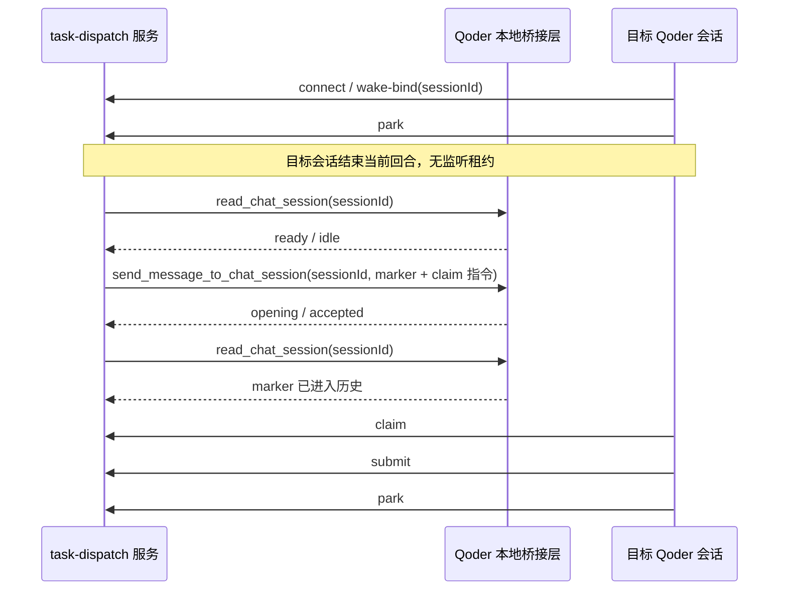

# 计划：将 Qoder 改为直接会话唤醒

> 状态：T0～T6 已实施并安装；等待重启 Qoder 后执行 T7 长时真实验收
>
> 已确认前提：Qoder 的 `mcp__builtin__send_message_to_chat_session` 可以唤醒另一个未归档 Qoder 会话。该能力已经由用户实测证明，不再重复论证目标会话能否被唤醒。

## 1. 问题与目标

当前 `task-dispatch` 的 Qoder 适配器依赖 Stop Hook：目标会话结束回合后启动后台监听器，每 500ms 检查一次唤醒文件，并在收到任务时用 `exit 2` 恢复会话。监听默认 60 秒、最长 600 秒。worker 执行数小时后，reviewer 的监听器已经退出，但角色绑定仍可能显示 `armed`，最终出现任务已进入审核、Qoder 却没有收到通知的阻塞。

本次改造后的行为：

- Qoder reviewer/brain/worker 绑定真实 `sessionId` 后可以长期待命，不需要目标会话维持 Hook、轮询进程或监听租约。
- task-dispatch 在任务到达时，通过 Qoder 的跨会话发送能力向目标会话投递带唯一 marker 的通知。
- `park` 只表达“该角色允许接收下一项任务”，不再创建或依赖 Qoder listener。
- 发送成功、发送不确定、目标繁忙、会话归档或不存在都有可观察状态和恢复路径。
- 旧 Hook 无保留价值，本次直接删除，不提供兼容模式或自动降级。

## 2. 已验证事实与剩余技术门槛

### 已验证

Qoder 活动会话可以执行以下调用链：

```text
list_chat_sessions
  → read_chat_session
  → send_message_to_chat_session
  → wait_chat_sessions
  → read_chat_session
```

其中 `send_message_to_chat_session` 能使目标会话进入 `opening` 并开始新回合。目标会话无需运行 Stop Hook。

### 已补齐的后台通道

现有 runtime 是独立 Node 进程，而 `mcp__builtin__*` 是 Qoder 活动会话内工具。Qoder CN 0.2.5 已确认提供 App Plugin API：`chat.observeTurn` 和 `chat.continueSession`。当前实现使用随 IDE 启动的 App Plugin 暴露仅限本机且带随机令牌的 HTTP 桥接。

1. App Plugin 通过 `chat.observeTurn` 读取目标会话状态。
2. App Plugin 通过 `chat.continueSession` 投递带唯一 `requestId` 的通知。
3. 不采用“保持一个 Qoder 模型会话永久运行并代发消息”的方案；它仍有会话生命周期、费用和递归调度问题。
4. 不把文件监听从轮询改成 `fs.watch` 当作最终修复；这只能减少轮询，不能消除 Hook 生命周期上限。

后台通道的 mock、安装和调度链测试已通过；真实 Qoder 通道将在应用重启加载插件后执行 T7。

## 3. 目标架构



桥接层只负责会话读取和消息投递，不持有 task-dispatch 角色凭据，不读取任务正文，不修改调度状态。正式任务仍由目标会话使用自己的 credential 执行 `claim` 获取。

## 4. 关键契约

### 4.1 会话绑定

- `provider=qoder` 绑定真实、未归档的 Qoder `sessionId`。
- 绑定时读取目标会话元数据，并校验 `cwd` 与项目工作区一致。
- 禁止绑定当前调度桥接会话自身，避免自我唤醒或递归转发。
- 绑定失败必须在前台返回结构化错误，不写入虚假的 `armed` 状态。
- Qoder 直接通道不要求 `model`，沿用目标会话已有模型配置。

### 4.2 状态映射

| Qoder 状态 | task-dispatch 判定 | 行为 |
| --- | --- | --- |
| `ready` / `idle` | `idle` | 可以发送 |
| `opening` / `running` | `active` | 暂缓发送，保留待投递 |
| `needs_attention` | `active` + 告警 | 不抢占交互，前台显示原因 |
| 已归档 / 不存在 | `unavailable` | 取消可唤醒标记并提示重新绑定 |
| 桥接层暂时不可达 | `unknown` | 保留任务，不改派、不宣称送达 |

实际状态名称以探针返回为准，在适配器中集中映射，不散落到调度核心。

### 4.3 投递、确认与幂等

- 每次通知继续使用唯一 `TASK-DISPATCH-WAKE:<attemptId>` marker。
- marker 同时作为 Qoder `requestId`，由会话续接 API 提供请求级幂等。
- `send_message_to_chat_session` 返回 `opening` 仅表示接收，不表示任务已完成。
- 发送返回不确定时记 `uncertain`，禁止盲目重发，等待人工或宿主状态核验。
- 明确的 busy/active 返回属于可重试状态，保留 `pending`，等下一次 monitor tick。
- `claim` 仍是任务所有权事实来源；唤醒通知不得直接把 attempt 标成已领取。

### 4.4 `park` 语义

- Qoder `park` 与 Codex/MiMo 一致：服务将绑定标记为 `armed=true` 后，目标会话结束当前回合。
- 删除 Qoder `park` 对 listener lease 的创建、清空和存活检查。
- `armed` 仅代表角色愿意接收任务；桥接可达性单独显示为 `reachable/status/error`。
- `claim` 后继续 `armed=false`，提交并再次 `park` 后恢复待命。

## 5. 实施任务

### T0：验证后台调用通道（已完成）

- 新增只读/测试探针，例如 `scripts/probe-qoder-session-wake.cjs`。
- 定位 builtin MCP 使用的本地传输和请求格式，或确定 Qoder 扩展桥接方案。
- 探针必须支持 `list/read`；发送测试必须显式传目标测试会话和 marker，禁止扫描后猜测目标。
- 记录 Qoder 版本、传输入口、鉴权边界、超时和返回格式。
- 验收：独立进程在目标会话没有活动回合时完成一次 `read → send → read`，历史中只出现一次 marker。

### T1：实现 Qoder 直接桥接客户端（已完成）

- 首选新增 `runtime/adapters/qoder-direct-wake.cjs`，封装 `sessions/messages/read/send`。
- 若必须使用 IDE 扩展，则将扩展放入独立目录，IPC 仅监听本机，使用随机握手令牌和受限文件权限；runtime 只保存端点描述，不保存会话内容。
- 设置请求大小、响应大小和超时上限；拒绝非预期方法和非本机连接。
- 对归档、不存在、繁忙、权限不足、接口不兼容和响应不确定分别返回稳定错误类型。
- 验收：适配器单元测试覆盖成功、重复 marker、busy、归档、桥接重启、超时和畸形响应。

### T2：切换 Qoder provider 的发送与读取路径（已完成）

- 修改 `runtime/adapters/qoder-wake.cjs`：默认导出直接唤醒实现，或将现有 Hook 实现拆为 `qoder-hook-wake.cjs`。
- 修改 `runtime/adapters/mimo-wake.cjs` 中的 provider 注册，确保 `qoder` 指向直接适配器。
- 保持 `runtime/core/wake.cjs` 的通用 marker、发送前复核和不确定投递处理，不在核心加入 Qoder 特判。
- 删除“没有 live listener 就不能发送”的判定。
- 验收：worker 运行超过原 600 秒上限后，Qoder reviewer 仍能收到审核通知并成功 `claim`。

### T3：修正绑定、待命和状态展示（已完成）

- 修改 `runtime/core/wake.cjs`、`runtime/core/monitor.cjs`、`runtime/wizard.cjs` 及必要的状态输出。
- `wake-bind --provider qoder` 直接校验目标会话，无需先安装 Hook 或等待 Stop 事件生成 descriptor。
- 状态输出区分 `bound`、`armed`、`reachable` 和最近一次投递结果。
- 桥接不可达时在前台显示明确错误；不得继续显示“已待命”却隐藏实际不可投递。
- 任务保留在可恢复状态，不因暂态不可达自动改派 reviewer。
- 验收：关闭桥接、归档目标会话、恢复桥接三种情况下，前台状态与真实情况一致，任务不会丢失或卡成虚假 `reviewing`。

### T4：删除旧 Hook 安装与绑定（已完成）

- 修改 `scripts/install.js`、`scripts/verify.js` 及 Qoder 安装配置，并删除 `skills/task-dispatch/qoder-hook.cjs`。
- 新安装不再强制注册 Stop/SessionEnd 轮询 Hook。
- 已安装 Hook 在直接通道启用后应快速退出且不影响正常会话。
- 删除旧 Hook 模式、监听文件和相关配置，直接通道失败时明确报错，不提供自动回退。
- 为现有 `provider=qoder` 绑定提供无状态迁移：保留 `sessionId`，首次 monitor/read 时转为直接通道；旧 listener/wake 文件只清理过期项。
- 验收：升级后不需要用户逐个重新绑定 Qoder 会话，且同一 attempt 不会被 Hook 和直接通道各发送一次。

### T5：更新测试（已完成）

- 重写 `tests/qoder.test.cjs`，将主路径从 listener lease 改为直接会话调用。
- 删除 legacy Hook 测试，所有 Qoder 测试只覆盖直接通道。
- 扩充 `tests/wake.test.cjs`、`tests/continuation.test.cjs`、`tests/connection.test.cjs` 和相关 UI/status 测试。
- 必测场景：
  - park 后超过 600 秒仍可投递；
  - 发送成功但响应丢失，通过 marker 复核确认；
  - 目标繁忙后恢复，通知只发送一次；
  - 目标归档/删除时给出可操作错误；
  - 服务和 Qoder 桥接分别重启后恢复；
  - reviewer 收到任务后 `claim → review submit → park` 完整闭环；
  - worker 执行数小时不会导致 reviewer 绑定失效。

### T6：更新文档与清理旧语义（已完成）

- 更新：
  - `skills/task-dispatch/SKILL.md`
  - `skills/task-dispatch/references/qoder.md`
  - `skills/task-dispatch/references/desktop.md`
  - `docs/runtime.md`
  - `README.md`
  - `CHANGELOG.md`
- 将 `docs/hook-wake/qoder会话自动唤醒方法.md` 作为直接会话能力依据，补充后台桥接调用方法和实测版本。
- 删除“Qoder 必须每 60～600 秒重新 park”的主流程说明。
- 明确 Qoder IDE/桥接进程必须运行；关闭应用仍无法接收通知。

### T7：真实端到端验收

在独立测试项目中连接 brain、长任务 worker 和 Qoder reviewer：

1. Qoder reviewer 执行一次 `connect/rebind → park` 后结束回合。
2. 确认不存在 Qoder Stop Hook 监听进程。
3. worker 保持运行或延迟提交，等待时间必须超过旧上限 600 秒。
4. worker 提交后，记录 Qoder 通知进入时间、marker、目标新回合和 claim 时间。
5. reviewer 提交审核并再次 park。
6. 触发一次返修，验证第二次通知仍能到达同一 Qoder 会话。
7. 重启 task-dispatch 服务后再执行一次，验证持久化恢复。

通过标准：全程不需要人工恢复 Qoder、重新连接或重新 park；每个 attempt 只有一条通知；任务状态最终正常进入 brain 终审或 accepted。

## 6. 验证命令

实施时按实际文件调整定向集合，至少执行：

```powershell
node --test tests/qoder.test.cjs tests/wake.test.cjs tests/continuation.test.cjs tests/connection.test.cjs
npm test
node scripts/verify.js
```

真实 Qoder 端到端测试不能由 mock 代替，测试结果写入新的实测总结，包含版本、会话状态、等待时长和通知 marker，禁止记录 credential、token 或完整私人会话列表。

## 7. 风险与回退

| 风险 | 处理 |
| --- | --- |
| builtin MCP 底层接口不是稳定公开 API | 封装在单一适配器中，启动时探测版本和能力，不兼容时前台报错 |
| 外部进程无法直接调用 builtin MCP | 使用 Qoder IDE 常驻扩展桥接，不退回活动模型中继 |
| 发送响应丢失导致重复消息 | 发送前后均按 marker 检查目标历史 |
| 目标会话繁忙 | 保持 pending，延迟重试，不抢占当前运行 |
| 升级残留旧 Hook 配置 | 安装升级时移除 task-dispatch 注册的旧 Hook 项，禁止双通道投递 |
| Qoder 应用关闭 | 状态显示 unavailable/unknown，保留任务并提示启动应用 |

如直接通道在真实端到端测试失败，回退范围仅为 Qoder provider 适配器和安装配置；现有通用调度、任务状态和其他 provider 不回退。旧 Hook 代码、安装项和测试在本次改造中一并删除。

## 8. 实施顺序与完成条件

执行顺序固定为 `T0 → T1 → T2 → T3 → T4 → T5 → T6 → T7`。T0 未证明后台调用能力时，不得直接删除 Hook，也不得宣称长时间唤醒已解决。

本计划完成条件：

- Qoder 主路径不再创建或等待 Stop Hook listener。
- 独立后台服务能按绑定的 `sessionId` 唤醒目标 Qoder 会话。
- 超过旧 600 秒期限的真实试跑成功。
- 前台能准确展示桥接不可达、会话归档、发送不确定等错误。
- 定向测试、全量测试和安装验证通过。
- 旧绑定可迁移，用户无需人工逐个恢复 reviewer。

## 生成记录

| 时间 | 操作 | 摘要 |
| --- | --- | --- |
| 2026-09-16 | 创建 | 基于已验证的 Qoder 跨会话唤醒能力，规划以直接会话投递替代限时 Stop Hook 轮询 |

