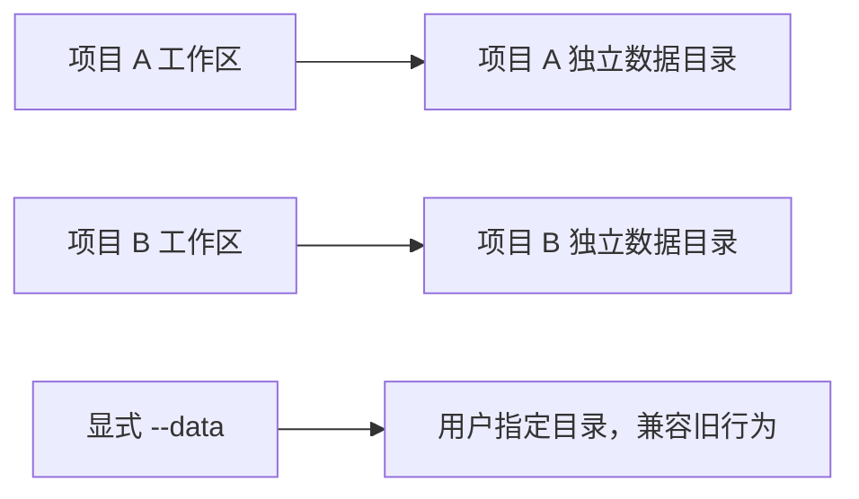

# 计划：将 task-dispatch 服务记录按项目独立存放

> **B 模型开工指令**：阅读本文档并严格执行；用户输入 `1` 前不得修改业务代码。

## 0. 执行者须知（写给 B 模型）

1. 本文档自包含全部上下文，不依赖历史对话、旧计划或旧总结。
2. 按任务顺序执行；每完成一项，将状态改为 `[x]` 并在“结果”栏记录。
3. 现场代码与本文档冲突时停下询问用户，不自行扩大范围。
4. 只做第 4 节任务；发现额外问题记录在第 7 节，不顺手修改。
5. 新增代码必须带 `[AI-added]` 和精确到分钟的日期，注释不得含中文。

## 1. 背景与目标

- 当前默认服务数据集中写入用户目录下的 `.task-dispatch-service`，其中同时包含多项目状态、角色凭据、连接描述、快照、审核副本、验证产物、事件和配置。用户无法通过删除单个项目对应目录来清除该项目记录，直接删除全局目录还会中断全部项目服务。
- 将桌面项目的默认服务数据改为“项目旁挂独立目录”：数据目录与源码工作区互不重叠，但一项目一目录。用户停止该项目服务后，可删除对应数据目录完成该项目的完整本地重置。
- 显式传入 `--data` 的行为保持不变，已有全局目录不自动迁移、不自动删除，避免无提示搬动或损坏现存任务。

### 可观察效果

- 新项目不传 `--data` 时，根据规范化工作区路径稳定计算其旁挂数据目录。
- 同名但路径不同的项目不会冲突。
- 后续命令优先沿用凭据中记录的数据目录，不会因当前终端目录变化连接到错误服务。
- 删除某项目数据目录不会删除源码，也不会删除其他项目记录；删除前仍必须先停止该项目服务。

## 2. 现状锚点（B 模型必读）

| 位置 | 现状 | 作用 |
|------|------|------|
| `runtime/wizard.cjs` `dataRoot` | 无 `--data` 时固定返回用户目录 `.task-dispatch-service` | 默认目录解析入口 |
| `runtime/desktop-client.cjs` | 启动早期即解析全局 root；凭据保存 `data` 并要求后续一致 | 桌面连接与命令路由 |
| `runtime/cli.cjs` | headless CLI 默认使用用户目录 | 旧命令兼容边界 |
| `scripts/install.js` | `runtime-link.json` 固化用户目录默认数据路径 | 安装后发现入口 |
| `skills/task-dispatch/qoder-hook.cjs` | 优先读取参数、环境变量或安装链接中的固定 data | Qoder 接入入口 |
| `runtime/core/storage.cjs` | 已提供 `workspaceKey`，可生成稳定且不泄露完整路径的项目键 | 路径命名复用点 |
| `runtime/core/dispatcher.cjs` | 强制工作区与服务数据目录不重叠 | 采用旁挂目录后继续保持的安全约束 |
| `tests/wizard.test.cjs`、`tests/connection.test.cjs` | 固定断言旧全局默认目录 | 回归测试修改点 |

- 构建/验证方式：见 `PROJECT.md`，在项目根目录运行 Node.js 测试。

## 3. 方案与关键决策

### 选定方案（推荐）

使用工作区旁的独立目录，目录名包含可读项目名和路径短摘要；统一的数据根解析函数执行以下优先级：

1. 命令行显式 `--data`；
2. 已有凭据中的 `data`；
3. 显式或当前工作区计算出的项目旁挂目录；
4. 只有无法确定工作区的旧 headless/管理入口才保留全局默认目录。

理由：满足一项目一目录和可独立删除，同时继续保持服务数据与受审源码互不重叠，不需要放宽快照、凭据或工作区安全校验。

### 未采用方案

- 将服务数据放进 `<workspace>/.task-dispatch-service`：删除方便，但会使令牌、日志和快照进入源码树，必须额外处理 Git、快照递归、允许路径和凭据边界，风险更高。
- 仅新增管理台“彻底删除项目”：可以清理记录，但不解决默认全局目录混放，也不满足按项目物理隔离。
- 立即拆分现有全局目录并自动迁移：共享状态、事件和产物引用需要事务迁移，出现中断时恢复复杂；本次保留旧目录并让用户显式决定是否删除。

## 4. 任务清单

### T1 建立统一的项目数据目录解析器

- 文件：新增 `runtime/core/data-root.cjs`，修改 `runtime/wizard.cjs` 与 `runtime/desktop-client.cjs`。
- 改动：封装显式参数、凭据路径和工作区默认目录的解析优先级；旁挂目录使用现有 `workspaceKey`；连接输出继续返回绝对数据目录。
- 验收：相同工作区稳定得到相同目录，不同路径不冲突；显式 `--data` 完全覆盖默认行为；后续命令优先使用凭据记录。
- 结果：新增 `runtime/core/data-root.cjs`，桌面客户端已按显式参数、凭据、工作区、旧默认值的顺序解析数据根。
- 状态：[x] 已完成

### T2 更新安装链接与平台接入

- 文件：`scripts/install.js`、`skills/task-dispatch/qoder-hook.cjs`，必要时调整安装/连接测试。
- 改动：安装链接表达“按工作区解析”的默认模式，不再把固定用户目录作为所有项目的默认数据根；Qoder 在可确认工作区时使用同一解析规则，缺少工作区时明确报错或要求 `--data`，不得猜测。
- 验收：安装产物不含过时的固定默认数据根；显式参数和环境变量仍保持最高优先级；各平台邀请继续携带最终绝对目录。
- 结果：安装链接升级为 version 2 / workspace-sibling-v1；Qoder 兼容旧链接并使用统一解析器，安装器继续排除退役 Hook；复核补齐缺少宿主工作区且未显式指定数据目录时的拒绝逻辑，不再回退猜测进程目录。
- 状态：[x] 已完成

### T3 保持旧数据兼容并增加删除安全提示

- 文件：`runtime/desktop-client.cjs`、`runtime/wizard.cjs`、相关帮助文本和测试。
- 改动：已有凭据继续连接旧全局目录；新项目不自动迁移旧数据；帮助信息明确“停止项目服务后才能删除目录”，运行中的目录不得宣称可安全删除。
- 验收：旧凭据回归通过；新连接与旧连接可分别工作；不会自动删除或移动用户现有 `.task-dispatch-service`。
- 结果：已有凭据自动沿用保存的 `data`；帮助文本明确旧目录不迁移及运行期间禁止删除。
- 状态：[x] 已完成

### T4 补齐自动化测试和用户文档

- 文件：`tests/wizard.test.cjs`、`tests/connection.test.cjs`、必要的新测试、`README.md`、`docs/runtime.md`、task-dispatch 接入说明。
- 改动：覆盖默认解析、同名项目隔离、凭据优先、显式覆盖、安装链接、停止后删除与旧数据兼容；同步更新操作示例。
- 验收：文档描述与实现一致，测试能阻止恢复为全局混放默认值。
- 结果：新增项目隔离、同名路径摘要、显式覆盖、旧凭据、真实 connect 和安装链接测试；用户文档已同步。
- 状态：[x] 已完成

## 5. 约束

- 禁止自动删除、移动或读取现有用户目录 `.task-dispatch-service` 中的业务记录。
- 禁止把服务数据、令牌或连接凭据放进项目源码工作区。
- 不放宽工作区与服务数据目录不重叠的校验。
- 不改变显式 `--data` 的语义，不破坏已有凭据中的 `data` 路径。
- 不修改无关模块，不读取历史计划、日志或总结内容。
- 新增代码加 `[AI-added]` 和日期（精确到分钟），注释不含中文。

## 6. 整体验证

- 构建/测试命令：`npm test`
- 完整验证命令：`node scripts/verify.js`
- 定向测试：运行数据目录解析、安装和连接相关测试文件。
- 通过标准：全部测试通过；显式 `--data` 与旧凭据兼容；两个不同工作区得到不同数据目录；默认目录位于工作区之外；没有自动迁移或删除现有数据。

## 7. 执行备注（B 模型回写）

- 当前工作目录未检测到 Git 元数据，执行时不能依赖 Git diff；需通过文件级检查和测试确认改动范围。
- 用户尚未提供额外验证方法，输入 `1` 时可同时附带；未附带则按第 6 节执行。
- `npm test` 最终 154/154 通过；`node scripts/verify.js` 通过。
- 首轮全量测试暴露 Qoder 安装载荷会重新写入退役 Hook，已在平台载荷生成阶段排除并完成回归。
- 继续复核发现旧 Qoder Hook 在缺少宿主工作区时会回退 `process.cwd()`；现已改为要求宿主工作区或显式 `--data`，并新增回归测试。

## 生成/修改记录

| 时间 | 模型 | 操作 | 摘要 |
|------|------|------|------|
| 2026-09-16 15:37 | GPT-5 | 创建 | 制定项目级服务数据目录实施计划 |
| 2026-09-16 16:08 | GPT-5 | 更新 | 回写全部任务结果和验证结论 |
| 2026-09-16 16:43 | GPT-5 | 更新 | 补齐 Qoder 缺失工作区时禁止猜测目录的边界与回归测试 |
