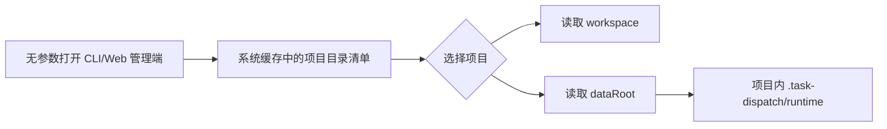

# 计划：由系统总目录清单自动定位项目

## 0. 执行者须知（写给 B 模型）

1. 本文档自包含全部上下文，不依赖任何会话历史。
2. 按任务顺序执行；每完成一项更新状态与结果。
3. 现场代码与本文档描述冲突时停止并询问用户。
4. 只做本计划任务清单内的事项。
5. 不迁移、停止或删除用户现有运行实例。

## 1. 背景与目标

- 当前实现把实际状态和凭据放入项目工作目录，但管理台在发现多个项目时仍要求用户传 `--workspace`，迁移工具也要求重复输入工作目录。
- 完成后，用户缓存仅保存一个无凭据的总目录清单；命令行管理台和 Web 管理端无参数启动即可列出全部项目并选择，所选项目的服务状态与凭据仍严格存放在其工作目录中。

## 2. 现状锚点（B 模型必读）

| 位置 | 现状 | 作用 |
|------|------|------|
| `runtime/core/service-registry.cjs` | `services` 条目保存服务根目录和 `workspaces`，尚未形成以项目为主键的目录表 | 总目录清单 |
| `runtime/wizard.cjs` | 发现多个候选服务时要求 `--workspace` 或 `--data` | 命令行管理台入口 |
| `runtime/server.cjs`、`runtime/web/` | 页面绑定单一服务根目录，缺少系统项目目录清单入口 | Web 管理端入口 |
| `runtime/core/data-root.cjs` | 无工作目录时回退旧用户级服务目录 | 路径解析 |
| `runtime/migrate-data.cjs` | 同时要求 `--workspace` 与 `--from` | 迁移入口 |

- 构建/验证方式：见 `PROJECT.md`。

## 3. 方案与关键决策

- 推荐方案（用户已确认）：把系统缓存中的索引升级为“项目目录清单”，每个项目条目明确保存 `projectId`、`workspace`、`dataRoot` 和最近状态；命令行管理台和 Web 管理端无参数打开目录清单并让用户选择项目。项目连接从宿主真实当前目录自动登记，迁移从旧服务状态读取工作目录，不要求用户输入 `--workspace`。
- 兼容边界：`--workspace`、`--data` 仅保留为高级兼容/诊断参数，不再作为正常使用前提；旧索引按读取时升级或兼容解析。

## 4. 任务清单

### T1 升级项目目录清单

- 文件：`runtime/core/service-registry.cjs`、`runtime/core/data-root.cjs`
- 改动：提供按项目列举、按项目定位和兼容旧索引的接口，避免以服务数量猜测当前项目。
- 验收：一个清单可准确列出多个项目的工作目录与各自项目内数据目录。
- 结果：注册表升级为版本 2，新增以工作目录为键的 `projects` 清单和兼容旧索引的 `catalog()` 视图。
- 状态：[x] 已完成

### T2 修正命令行管理台与迁移入口

- 文件：`runtime/wizard.cjs`、`runtime/migrate-data.cjs` 及相关说明
- 改动：管理台无参数进入项目选择；迁移只需旧数据目录并从其状态中确定工作目录；兼容参数仍可显式覆盖。
- 验收：多项目情况下不再报错要求 `--workspace`，迁移预览不需要该参数。
- 结果：命令行管理台无参数展示项目选择；Web 启动器无参数选用已登记入口；迁移从旧状态自动识别唯一工作目录。
- 状态：[x] 已完成

### T3 增加 Web 项目目录入口

- 文件：`runtime/server.cjs`、`runtime/web/index.html`、`runtime/web/app.js` 及相关管理接口
- 改动：Web 管理端展示系统目录清单，支持刷新、选择项目、显示离线/失效状态，并连接所选项目内服务；页面不得接触角色凭据。
- 验收：无 `--workspace` 打开 Web 管理端可看到所有登记项目并进入对应项目管理视图。
- 结果：Web 汇总页展示全部清单项目，失效目录保留提示；跨服务项目可一键启动/复用目标服务并通过一次性票据跳转。
- 状态：[x] 已完成

### T4 回归验证

- 文件：相关测试文件
- 改动：补充多项目目录选择、旧索引兼容、无 `--workspace` 迁移测试。
- 验收：全量测试通过，且现有服务未被修改或迁移。
- 结果：全量 `npm test` 171/171 通过，`node scripts/verify.js` 全部通过。
- 状态：[x] 已完成

## 5. 约束

- 禁止修改或删除用户现有服务实例及其数据。
- 新增代码必须带 `[AI-added]` 与精确到分钟的日期，注释不含中文。
- 系统目录清单不得保存令牌；凭据仍严格保存在项目目录中。

## 6. 整体验证

- 构建命令：`npm test`
- 测试/运行命令：`node scripts/verify.js`
- 通过标准：无参数可列出多项目；正常路径不要求 `--workspace`；旧索引可兼容；全量测试通过。

## 7. 执行备注（B 模型回写）

- 系统清单不含任何管理员令牌或角色凭据；Web 跨服务跳转仅在内存中使用目标服务的一次性登录票据。
- 旧版 `--workspace`/`--data` 保留为兼容和诊断覆盖，不再是正常启动要求。

## 生成/修改记录

| 时间 | 模型 | 操作 | 摘要 |
|------|------|------|------|
| 2026-09-17 13:44 | GPT-5 | 创建 | 记录目录清单优先的修正计划 |
| 2026-09-17 13:52 | GPT-5 | 更新 | 纳入 Web 管理端项目目录与选择支持 |
| 2026-09-17 14:04 | GPT-5 | 更新 | 回写实现结果与全量验证结论 |
