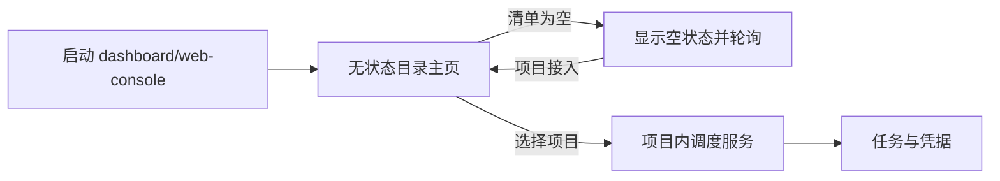

# 计划：空系统也能进入 CLI 与 Web 管理主页

## 0. 执行者须知（写给 B 模型）

1. 本文档自包含全部上下文，不依赖历史记录。
2. 按任务顺序执行并即时回写结果。
3. 现场代码与计划冲突时停止并询问用户。
4. 不创建用户级空调度实例。
5. 不改动、停止或迁移用户现有项目服务。

## 1. 背景与目标

- 当前 CLI 和 Web 启动器在系统项目清单为空时直接报错，无法进入管理主页。
- 完成后，管理入口始终可用；空系统显示空状态并持续刷新目录清单，项目或任务加入后自动出现。实际调度状态与凭据仍严格存放在项目工作目录。

## 2. 现状锚点（B 模型必读）

| 位置 | 现状 | 作用 |
|------|------|------|
| `runtime/wizard.cjs` | 无项目时在选择服务根目录前报错 | CLI 管理入口 |
| `runtime/web-console.cjs` | 必须由 `bootstrapRoot()` 找到项目服务才能启动 | Web 启动入口 |
| `runtime/web/app.js` | 页面连接单一项目服务的管理 API 和事件流 | 项目管理页面 |
| `runtime/core/service-registry.cjs` | 已可返回空或多项目目录清单 | 无状态数据来源 |

- 构建/验证方式：见 `PROJECT.md`。

## 3. 方案与关键决策

### 方案 A：创建用户级空调度服务

- 思路：清单为空时在系统缓存创建一个完整服务承载页面。
- 影响：改动较少。
- 风险：重新引入全局实例、状态和管理员凭据，与项目严格隔离的既定要求冲突。

### 方案 B：无状态系统目录管理入口（推荐）

- 思路：CLI 增加目录模式；Web 增加仅监听本机的轻量目录主页。它们只读取系统项目清单，不创建调度状态。页面轮询清单，项目出现后启动/复用对应项目内服务并跳转。
- 影响：新增目录入口接口和空状态页面，保留现有项目管理页。
- 风险：需覆盖目录页登录、轮询和跨服务跳转测试；入口进程不承担业务操作。
- 推荐理由：管理入口与项目服务生命周期彻底解耦，同时保持系统缓存只有目录清单。

## 4. 任务清单

### T1 CLI 空目录模式

- 文件：`runtime/wizard.cjs`
- 改动：无项目时仍进入目录菜单，支持刷新/等待；项目出现后选择并进入现有项目控制菜单。
- 验收：`dashboard.bat` 在空清单下不报错退出。
- 结果：CLI 在空清单时进入刷新/退出菜单，不创建服务；项目登记后可继续选择项目。
- 状态：[x] 已完成

### T2 Web 无状态目录主页

- 文件：新增目录 Web 入口模块及静态页面、`runtime/web-console.cjs`
- 改动：始终启动轻量目录主页，提供只读目录 API、周期刷新和“打开项目”；不保存项目状态或凭据。
- 验收：空清单进入主页；项目出现后无需重启自动显示；选择项目进入对应项目管理台。
- 结果：新增内存态目录服务与独立主页，每 2 秒刷新项目和任务计数，选择项目后使用一次性票据进入项目管理台。
- 状态：[x] 已完成

### T3 回归与文档

- 文件：相关测试与使用文档
- 改动：覆盖空清单、动态加入项目、无任务项目和项目跳转。
- 验收：全量测试和安装验证通过。
- 结果：新增空清单、动态项目、动态任务和跨服务打开测试；全量 174/174 及安装验证通过。
- 状态：[x] 已完成

## 5. 约束

- 禁止在用户缓存创建空调度服务、角色凭据、任务状态或管理员长期令牌。
- 新增代码带 `[AI-added]` 与精确到分钟日期，注释不含中文。
- 目录服务只监听 `127.0.0.1`，跨项目打开仍使用短期一次性登录票据。

## 6. 整体验证

- 构建命令：`npm test`
- 测试/运行命令：`node scripts/verify.js`
- 通过标准：空系统 CLI/Web 可进入；动态项目与任务自动刷新；项目数据仍严格项目内；全量回归通过。

## 7. 执行备注（B 模型回写）

- 目录服务不写 endpoint、令牌或会话到系统缓存；全部登录状态只驻留内存。
- `--data`/`--workspace` 继续支持直接打开兼容项目服务。

## 生成/修改记录

| 时间 | 模型 | 操作 | 摘要 |
|------|------|------|------|
| 2026-09-17 14:13 | GPT-5 | 创建 | 记录空系统管理入口修复计划 |
| 2026-09-17 14:28 | GPT-5 | 更新 | 回写实现、验证与安全收尾结果 |
