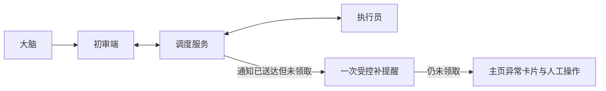

# 计划：修复返修唤醒卡住并优化管理台异常处置

## 0. 执行者须知（写给 B 模型）

1. 本文档自包含全部上下文，不读取或依赖既有 `docs/logs/`、`docs/plans/` 历史记录。
2. 按任务顺序执行；每完成一项，将状态改为 `[x]` 并在“结果”栏记录结论。
3. 现场代码与本文档描述冲突时停止并询问用户，禁止自行扩大范围。
4. 只做第 4 节任务清单内的工作；额外发现只写入第 7 节。
5. 新增代码必须添加 `[AI-added] 2026-09-17 HH:mm` 英文注释。

## 1. 背景与目标

- 大脑审核返回 `needs_fix` 后，服务能生成新的 worker attempt，但唤醒层只记录消息已发送，不检查目标会话是否实际 `claim`。消息被平台接收但未驱动客户端时，任务永久停在“在途未领取”。
- 管理台能展示阻塞、未领取和通知异常，却缺少与异常状态相匹配的直接操作；常用项目/任务操作全部藏在“后台控制”弹窗。
- 拓扑图把 reviewer 与 worker 同放在右侧，需要把初审端移到 brain 与调度服务之间，形成清晰的审核链路。

完成后的可观察效果：

## 2. 现状锚点（B 模型必读）

| 位置 | 现状 | 作用 |
|------|------|------|
| `runtime/core/dispatcher.cjs` L254-L270 | 审核 `needs_fix` 将任务切回 `ready`，随后可创建 worker attempt | 返修调度入口 |
| `runtime/core/wake.cjs` L84-L116 | `wakeNotice.status === sent` 后直接跳过，未检查 claim | 卡住根因 |
| `runtime/admin.cjs` L72-L118 | `wake-retry` 只允许 `pending`，异常操作入口不足 | 后台恢复能力 |
| `runtime/core/monitor.cjs` L156-L179 | 能展示 worker missing、blocked、uncertain，但无未领取超时告警 | 监控影响面 |
| `runtime/web/app.js` L91-L122 | 拓扑只分 brain 与其他角色两组 | 初审端位置问题 |
| `runtime/web/index.html` | 所有操作集中在后台控制弹窗 | 主页快捷操作影响面 |
| `tests/wake.test.cjs`、`tests/pre-review.test.cjs`、`tests/admin.test.cjs` | 缺少返修自动唤醒后未领取治理的端到端用例 | 回归测试入口 |

- 构建/验证方式：在项目根目录执行 Node.js 测试与 skill 验证，见 `PROJECT.md`。

## 3. 方案与关键决策

### 方案 A：只增加后台人工重试

- 思路：允许管理员对 `sent-but-unclaimed` attempt 再次发送提醒。
- 影响面：wake 状态机、管理命令、Web 表单、测试。
- 风险：依赖人工发现，流程仍会长时间静默卡住。

### 方案 B：受控自动补提醒 + 异常告警 + 人工恢复（推荐）

- 思路：首次通知已发送但在宽限期内未 claim 时，只自动发送一次带独立幂等标记的补提醒；仍未领取则停止自动发送并产生明确告警。主页提供“再次提醒/重试/改派/追加额度”等与状态匹配的操作。
- 影响面：wake 状态机、监控快照、管理命令、管理台、测试和说明文档。
- 风险：平台延迟时可能多出现一条提醒；通过宽限期、单次上限、独立 marker 和 claim 前状态复核控制重复风险。
- 推荐理由：既修复无人推进，又保留“通知不等于领取”和“不盲目无限重发”的安全边界。
- 用户决策：已于 2026-09-17 18:42 输入 `1` 确认采用。

### 方案 C：通知发送后由服务直接标记为已领取

- 思路：把送达等同 claim。
- 风险：会伪造所有权和执行事实，可能造成状态污染，不采用。

### UI 信息架构建议

- 主页项目级操作：暂停/继续、结束/重新开启。
- 主页异常任务操作：重试阻塞、追加额度、改派执行员、再次提醒未领取端。
- 继续保留在后台控制：改绑/取消改绑、解绑、清理预览与执行、归档/恢复/永久删除、完全重置任务、停止服务。
- 拓扑顺序：`大脑 → 初审端 → 调度服务 → 执行员`；无 reviewer 时保留“初审端待接入”占位，不再与 worker 堆叠。

## 4. 任务清单

### T1 修复返修任务的未领取卡住

- 文件：`runtime/core/wake.cjs`、`runtime/core/monitor.cjs`、必要的状态辅助模块。
- 改动：为 sent-but-unclaimed 增加宽限期、最多一次自动补提醒、独立幂等 marker、最终 stalled 告警；发送前复核 attempt、binding、armed、claimedBy 与项目状态。
- 验收：大脑/初审退回后 worker 在已 park 条件下收到任务；首次送达未 claim 会补提醒一次；仍未 claim 只告警不循环发送。
- 结果：已实现领取宽限、一次自动补提醒、最终 stalled 告警、状态复核及宿主读取/发送硬超时隔离。
- 状态：[x] 已完成

### T2 增加异常状态的后台操作能力

- 文件：`runtime/admin.cjs`、`runtime/web/app.js`、`runtime/web/index.html`。
- 改动：为未领取任务提供显式再次提醒；根据 blocked/uncertain/pending/sent-unclaimed 状态校验可用操作，沿用 commandId、revision 和确认保护。
- 验收：管理员可推进可恢复异常；不允许重发 uncertain 或已领取 attempt；陈旧操作被 revision/attemptId 拒绝。
- 结果：已新增 wake-remind，要求确认、原因、当前 attempt 和确定投递状态。
- 状态：[x] 已完成

### T3 将常用控制移到主页上下文

- 文件：`runtime/web/index.html`、`runtime/web/app.js`、`runtime/web/style.css`。
- 改动：增加项目快捷操作区和异常任务操作按钮；共用现有命令提交逻辑，高级/危险操作仍在后台控制弹窗。
- 验收：无需进入后台控制即可处理常见项目状态和异常任务；按钮按当前状态显示/禁用并解释影响。
- 结果：已增加项目主页操作条与任务卡片状态操作，复用原命令对话框与收据协议。
- 状态：[x] 已完成

### T4 调整角色拓扑布局

- 文件：`runtime/web/app.js`、`runtime/web/style.css`。
- 改动：将 brain、reviewer、service、worker 分为四个有序区域，reviewer 独立显示在中间；适配窄屏。
- 验收：桌面端呈现“大脑—初审端—调度服务—执行员”，移动端不溢出；多 worker 仍可纵向排列。
- 结果：已调整为大脑—初审端—调度服务—执行员四段布局并支持横向窄屏浏览。
- 状态：[x] 已完成

### T5 补齐自动化回归测试与文档

- 文件：`tests/wake.test.cjs`、`tests/pre-review.test.cjs`、`tests/admin.test.cjs`、现有管理台/运行时说明文档。
- 改动：覆盖返修自动唤醒、未领取补提醒上限、人工再次提醒、状态/权限/陈旧命令保护、主页操作配置与拓扑结构。
- 验收：相关定向测试和全量 `npm test` 通过，`npm run verify:skill` 通过。
- 结果：新增返修唤醒、自动补提醒上限、人工提醒、陈旧 attempt 和主页结构测试；全量 178 项与 skill 验证通过。
- 状态：[x] 已完成

## 5. 约束

- 禁止读取或引用既有 `docs/logs/`、`docs/plans/` 历史内容。
- 不把“通知已发送”伪装成“任务已领取”。
- 不对 `uncertain` 投递自动重发；自动补提醒必须有次数上限和独立幂等标记。
- 不改变候选审核、attempt 所有权、快照与提交协议。
- 新增代码加 `[AI-added]` + 精确到分钟的英文注释。

## 6. 整体验证

- 定向测试：`node --test tests/pre-review.test.cjs tests/wake.test.cjs tests/admin.test.cjs`
- 全量测试：`npm test`
- Skill 验证：`npm run verify:skill`
- 通过标准：所有测试通过；返修任务可被 worker 实际 claim；补提醒不超过一次；主页操作与后台命令状态保护一致；拓扑布局满足截图要求。

## 7. 执行备注（B 模型回写）

- 用户未提供额外复现命令，按代码状态机和自动化场景验证。
- 方案确认后创建并伴随更新技术方案文档；修复总结在根因已确定的基础上继续补充。
- `npm test`：182/182 通过；`npm run verify:skill`：通过。

## 生成/修改记录

| 时间 | 模型 | 操作 | 摘要 |
|------|------|------|------|
| 2026-09-17 17:38 | GPT-5 | 创建 | 基于当前代码建立修复与管理台调整计划 |
| 2026-09-17 18:42 | GPT-5 | 更新 | 记录用户确认方案 B，进入执行阶段 |
| 2026-09-17 18:54 | GPT-5 | 更新 | 完成全部任务并记录验证结果 |
| 2026-09-17 20:24 | GPT-5 | 更新 | 根据真实试跑补充宿主悬挂超时隔离与回归结果 |
