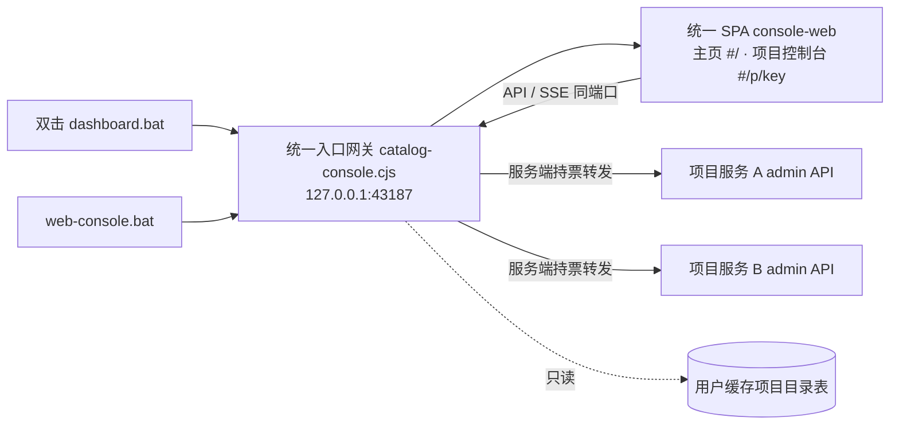

# 计划：双击 dashboard.bat 直达统一 Web 管理台（单端口 + 网关合并两套前端）

> **模板用法**：复制本模板填写，存为 `docs/plans/YYYY-MM-DD-<主题>.md`；用户审阅通过并输入 1 后，交执行者执行。
> **执行者开工指令**：阅读 docs/plans/2026-09-18-统一Web管理台.md 并严格执行。

## 0. 执行者须知（写给执行者）

1. 本文档自包含全部上下文，不依赖任何会话历史
2. 按任务顺序执行；每完成一项，将状态改为 `[x]` 并在"结果"栏一句话记录
3. 现场代码与本文档描述冲突时：**停下询问用户**，禁止自行发挥
4. 只做第 4 节任务清单内的事；发现"顺便可以改"的，记入第 7 节执行备注，不动手
5. 受第 5 节约束保护的内容，任何情况下不得修改

## 1. 背景与目标

- 为什么做：当前 Web 前端两套（`runtime/catalog-web/` 浅色目录页、`runtime/web/` 暗色项目管理台），点击项目后浏览器跳转到项目服务自己的动态端口，会话与样式割裂（用户评价"四不像"）；`dashboard.bat` 实际是 CLI 终端菜单，无参数启动还要人工选择项目目录。子页面信息架构也存在重复：管理台侧边栏"全局总览+项目列表"与目录主页的项目卡片是两套跨项目聚合；服务状态在状态条/头部 pill/侧边栏底部出现三处；"需要关注"在统计卡片、右侧告警栏、任务列表异常项重复；快捷操作区与后台控制对话框入口分层不清。
- 完成后的可观察效果：双击 `dashboard.bat` 直接打开浏览器统一主页（默认 127.0.0.1:43187，被占用顺延，已运行则复用并重开登录链接）；主页按用户缓存项目目录表（`%LOCALAPPDATA%\task-dispatch\service-registry.json`）逐项目显示卡片；点击卡片在同一端口内（hash 路由）进入该项目控制台，不再跳转其他端口；控制台只承载单项目的"总览/任务/事件"三个页签与统一的后台控制对话框，跨项目聚合只保留在主页；全部页面同一套设计系统（沿用现有管理台的亮/暗双主题 CSS 变量）。

## 2. 现状锚点（执行者必读）

| 位置 | 现状 | 作用 |
| -------------- | ------------------ | ------- |
| `dashboard.bat` L1-L13 | 调用 `runtime/wizard.cjs`，CLI 终端菜单 | 本计划修改对象（改入口指向） |
| `runtime/wizard.cjs` L72-L203 | CLI 菜单主流程；同时被 catalog-console 以模块方式复用 `dataRoot/initialize/request/online/start` | 保留不改逻辑，仅不再是 dashboard.bat 默认入口 |
| `runtime/web-console.cjs` L24-L43 | 无参数启动目录主页（43187）或复用已运行实例；`--data/--workspace` 走 directProject | 本计划修改对象（保持入口语义，dashboard.bat 复用它） |
| `runtime/catalog-console.cjs` | 无状态目录服务：ticket/login/session、`/catalog/api/projects`、`/catalog/api/open`（open 返回跨端口 URL） | 本计划修改对象（扩展为网关） |
| `runtime/catalog-web/`（3 文件） | 目录主页前端，浅色独立样式 | 本计划退役（见 T5，注释标注保留） |
| `runtime/web/`（3 文件） | 项目管理台前端（33KB app.js）：侧边栏含"全局总览+项目列表"跨项目聚合，服务状态三处重复，"需要关注"三处重复 | 本计划退役（见 T5），功能按新信息架构重组后迁入 `runtime/console-web/` |
| `runtime/admin.cjs` | 项目服务内嵌管理端：ticket(bearer)→login(cookie+CSRF)→overview/events/commands/diagnostics/stream | 只读依赖，网关复用其接口，本计划不修改 |
| `runtime/core/service-registry.cjs` | 用户缓存项目目录表（`catalog()` 返回 key/projectId/workspace/dataRoot/online 等） | 只读依赖，本计划不修改 |
| `runtime/core/data-root.cjs`、`runtime/core/storage.cjs` | 数据目录解析、原子读写、alive 判断 | 只读依赖，本计划不修改 |

- 构建/验证方式：按 PROJECT.md，项目根目录执行 Node.js 验证命令，无独立构建目录。

## 3. 方案与关键决策

- 总体思路：

- 决策记录（执行者遇到计划未覆盖的细节时，据此推断作者意图）：
  - 选定「目录服务升级为网关、浏览器只连 43187」，因为用户明确要求合并、双击直达、不跳端口。
  - 否决「只统一两套前端样式、保留跨端口跳转」，因为跳转本身是用户投诉点。
  - 否决「目录进程直接读各项目 state.json 渲染、绕过项目服务」，因为控制命令必须经项目服务的授权/收据边界，且离线项目无法操作。
  - 网关服务端会话：对每个项目服务用 admin-token 走 `POST /admin/ticket` → `POST /admin/login`（服务端 fetch 显式设置 Origin 头）换取 cookie+CSRF，仅保存在目录进程内存，不落盘、不返回浏览器；401 时重新登录重试一次。
  - 前端路由用 hash（`#/`、`#/p/<key>`），因为现有登录票据也是 hash 传递，避免引入 history 路由回退处理。
  - 选定「主页独占跨项目聚合，控制台只做单项目」：删除管理台的"全局总览"视图与侧边栏项目列表（项目切换一律回主页），因为两处项目列表是用户投诉的重复根源；`runtime/admin.cjs` 不改，其 overview 仍返回聚合快照，前端按当前项目的 workspace/projectId 过滤出单项目渲染。
  - 选定「控制台三页签（总览/任务/事件）+ 唯一后台控制对话框」：服务状态（运行灯、PID、版本、运行时长、启动时间）合并为顶栏一处紧凑显示，删除独立状态条与侧边栏底部重复；"需要关注"只保留总览页签内一处告警列表，统计卡片的对应计数点击跳转到该列表；删除独立快捷操作区，常用操作按上下文挂在任务卡片/告警项上，危险与高级操作统一收进后台控制对话框。
  - 旧 CLI 向导保留为 `dashboard.bat --cli`；`wizard.cjs` 文件不删不改主流程（它仍被 catalog-console 引用）。
  - 旧前端目录遵守团队「注释取代删除」规则：文件头加废弃标注保留在仓库（见 T5），不物理删除。

## 4. 任务清单

### T1 目录服务升级为网关

- 文件：`runtime/catalog-console.cjs`
- 改动：
  - 新增服务端会话池：`key → { cookie, csrf, expiresAt }`，内存 Map；登录流程复用现有 `openProject` 中的启动/票据逻辑（bearer→ticket→login，fetch 显式带 Origin）。
  - 新增路由（均需目录会话 + CSRF，POST 校验 Origin）：
    - `POST /catalog/api/p/<key>/ensure`：确保项目服务在线（未运行则 `wizard.start`），返回 `{ online: true }`；取代旧 `/catalog/api/open` 的跨端口跳转语义（旧 open 路由按团队规则注释保留并标注废弃）。
    - `GET /catalog/api/p/<key>/overview`、`GET /catalog/api/p/<key>/events?<query>`、`GET /catalog/api/p/<key>/diagnostics?<query>`：转发到对应项目服务 `/admin/api/*`，响应透传（diagnostics 保留 Content-Disposition）。
    - `POST /catalog/api/p/<key>/commands`：转发命令体，带服务端会话 cookie + X-CSRF-Token。
    - `GET /catalog/api/p/<key>/stream`：SSE 转发，参考 `runtime/admin.cjs` L189-L198 的背压处理；目录会话过期则关闭流。
  - 转发失败（服务未起/超时）返回 400 `{error}` 中文提示；项目 key 不在目录清单返回 404。
  - 静态资源指向新目录 `runtime/console-web/`（assets 映射同步改）。
- 验收：`node --test tests/catalog-console.test.cjs`（含 T4 新增用例）通过；手动 ensure 一个离线项目后 overview 能取到快照。
- 结果：完成。网关会话池 + ensure/overview/events/diagnostics/commands/stream 路由落地，旧 open 路由与 openProject 按规则注释保留。
- 状态：[x] 已完成（2026-09-19）

### T2 统一前端 runtime/console-web/

- 文件：`runtime/console-web/index.html`、`runtime/console-web/app.js`、`runtime/console-web/style.css`（新建三文件，UTF-8 无 BOM，文件头加 `[AI-added]` + 日期分钟）
- 改动：
  - 设计系统以 `runtime/web/style.css` 的 CSS 变量双主题为基准抽取，主页与控制台同一套变量与组件（卡片、面板、pill、按钮、页签、对话框）。
  - 主页 `#/`（独占跨项目聚合）：
    - 顶栏：品牌「Task Dispatch」、主题切换、立即刷新。
    - 汇总条：已登记项目数 / 运行中服务数 / 未完成待办合计 / 最近刷新时间。
    - 项目卡片网格（数据源 `/catalog/api/projects`）：项目名（工作区末段）、完整 workspace 路径、状态 pill（运行中/已暂停/已完成/工作目录缺失/缓存不可用）、任务数与未完成数、「进入控制台」按钮（先 `ensure` 再切路由 `#/p/<key>`）。
    - 空目录：引导文案（在项目会话执行 `start.bat connect`），保持每 2 秒轮询，项目接入自动出现。
  - 项目控制台 `#/p/<key>`（只管单项目，按 overview 快照中匹配的 workspace/projectId 过滤渲染）：
    - 顶栏：「← 返回目录」、项目名与路径、唯一服务状态区（运行灯 + PID/版本/运行时长/启动时间）、刷新、主题切换、导出诊断、「后台控制」按钮。
    - 页签一「总览」：项目状态（暂停/完成/归档）、统计卡片（任务各状态计数、绑定端数；计数点击跳转对应页签或筛选）、连接与交接（拓扑 + 端表）、需要关注（唯一告警列表，告警项带上下文操作入口）。
    - 页签二「任务」：任务列表（进行中与异常/全部筛选）+ 选中任务时间线详情（attempts、进度、唤醒通知、逐次用量）；异常任务卡片内联重试/追加次数/改派/再次提醒入口。
    - 页签三「事件」：SSE 实时流 + 搜索、等级/平台筛选、暂停滚动、历史分页。
    - 后台控制对话框：承载全部高级/危险操作（暂停/继续、结束/重开、解绑、改绑、清理、归档/删除/重置、停止服务等），保留状态版本校验、确认影响勾选与命令收据幂等。
    - 删除项（相对旧管理台）：侧边栏与"全局总览"、移动端项目下拉、独立服务状态条、独立快捷操作区、右侧常驻详情栏（详情改为任务页签内联展开）。
  - 登录：沿用 hash ticket → `/catalog/login` → cookie+CSRF，8 小时会话；401 时提示重新双击 dashboard.bat。
- 验收：浏览器从主页进入项目控制台地址栏端口不变（始终 43187）；暗色/亮色主题切换一致；任务操作（暂停/重试等）经网关成功返回收据；旧管理台功能（连接表、任务时间线、事件筛选分页、诊断导出、后台控制全部操作）在新控制台均可达成，且无"全局总览/侧边栏项目列表"入口。
- 结果：完成。`runtime/console-web/` 三文件落地：主页汇总条+卡片网格+空态；控制台三页签、顶栏唯一服务状态区、内联详情、后台控制对话框含生命周期操作。
- 状态：[x] 已完成（2026-09-19）

### T3 入口收敛

- 文件：`dashboard.bat`、`web-console.bat`、`README.md`、`docs/admin-console.md`
- 改动：
  - `dashboard.bat`：默认改为 `node "%~dp0runtime\web-console.cjs" %*`（保留 node 版本检查与非零暂停）；`if /i "%~1"=="--cli"` 分支走原 `runtime\wizard.cjs`。旧调用以注释形式保留并标注 `[AI-added]` 说明。
  - `web-console.bat`：保持不变（已是统一入口）。
  - `README.md` L29（任务看板与控制台段）与 L3（实时 Web 管理台段）更新为新入口语义；`docs/admin-console.md` 启动一节同步更新（单端口、网关、不再跨端口）。
- 验收：双击 `dashboard.bat` 打开浏览器主页，无终端选目录；`dashboard.bat --cli` 进入原 CLI 菜单。
- 结果：完成。dashboard.bat 默认走 web-console.cjs，`--cli` 走 wizard.cjs；README 与 admin-console.md 同步更新。
- 状态：[x] 已完成（2026-09-19）

### T4 测试

- 文件：`tests/catalog-console.test.cjs`
- 改动：新增网关用例——假项目服务（node http 模拟 admin.cjs 的 ticket/login/overview/commands/stream）下：ensure 启动缺失服务报错路径、overview 转发、commands 转发带 CSRF、401 后自动重登录一次、stream 首帧 snapshot 到达、目录会话校验（无 cookie 401、错 Origin 403）。沿用现有测试的临时目录与 `registryOptions` 注入方式。
- 验收：新增用例全部通过；`node --test tests/admin.test.cjs tests/wizard.test.cjs tests/service-registry.test.cjs` 不回归。
- 结果：完成。新增 fixture 与两个网关用例（守卫/ensure/转发/SSE 首帧、服务重启后会话重建），旧 open 用例注释保留；4/4 通过。
- 状态：[x] 已完成（2026-09-19）

### T5 旧前端退役标注与收尾

- 文件：`runtime/catalog-web/index.html`、`runtime/catalog-web/app.js`、`runtime/catalog-web/style.css`、`runtime/web/index.html`、`runtime/web/app.js`、`runtime/web/style.css`
- 改动：六个文件头部加注释标注「已废弃，由 runtime/console-web/ 取代（2026-09-18 统一入口改造）」，按团队规则注释取代删除，文件保留；确认仓库内无其他引用（Grep `catalog-web`、`runtime/web`），残留引用记入第 7 节。
- 验收：全仓库无活代码引用旧前端目录。
- 结果：完成。六个文件头加英文废弃标注。例外记录：`runtime/admin.cjs` 仍从 `runtime/web/` 提供项目服务自管的 `/admin/` 页面（受第 5 节禁改保护，`--data` 直达兼容路径继续可用），`tests/admin.test.cjs` 仍断言该目录文件存在。
- 状态：[x] 已完成（2026-09-19）

## 5. 约束

- 禁止修改：`runtime/admin.cjs`、`runtime/server.cjs`、`runtime/core/` 全部、`runtime/wizard.cjs` 主流程、`runtime/desktop-client.cjs`；项目服务鉴权模型（ticket/login/CSRF/收据）不得改动。
- 代码标记：新增非MD文档的代码加 `[AI-added]` + 日期（精确到分钟），注释不含中文。
- 其他：新文件 UTF-8 无 BOM；临时文件放 `tmp/` 并在任务结束后清理；管理员令牌与目录 token 不得出现在页面、日志或缓存文件中；保持只监听 127.0.0.1 与现有 host/origin 校验。

## 6. 整体验证

- 构建命令：无（PROJECT.md：项目根目录执行 Node.js 验证命令）
- 测试/运行命令：`node --test tests/catalog-console.test.cjs tests/admin.test.cjs tests/wizard.test.cjs tests/service-registry.test.cjs`；`node scripts/verify.js`
- 通过标准：上述测试全绿；双击 `dashboard.bat` 打开 43187 主页；有项目时卡片数量与目录表一致；进入项目控制台端口不变、SSE 快照与事件到达、一次暂停/继续命令成功。

## 7. 执行备注（执行者回写）

- `tests/wizard.test.cjs` 的「data roots isolate projects…」用例在本机会读真实用户缓存目录表（本机已有 80+ 登记项目）而失败，属既有环境依赖问题，与本次改动无关；隔离 HOME/USERPROFILE/LOCALAPPDATA 后该文件 5/5 通过。建议后续给该用例注入 `registryOptions`/`home` 隔离（未做，超出本计划范围）。
- `runtime/admin.cjs` 未改动（第 5 节约束），项目服务自带的 `/admin/` 旧版页面仍可经 `dashboard.bat --data/--workspace` 直达，作为兼容路径保留。
- 本次未提升版本号（VERSION 0.6.1 未动）；建议下个正式发布时补 CHANGELOG 并同步 package.json/插件清单。
- 冒烟：`node --test tests/catalog-console.test.cjs` 4/4，`tests/admin.test.cjs`、`tests/service-registry.test.cjs` 全过，`node scripts/verify.js` 全过；`serve()` 冒烟确认主页/JS/CSS 均来自 console-web。

## 生成/修改记录

| 时间 | 模型 | 操作 | 摘要 |
| ------------------ | --------- | -- | -- |
| 2026-09-18 23:22 | Kimi-K3 | 创建 | 初版：单端口网关 + 统一 SPA + dashboard.bat 直达 |
| 2026-09-19 00:12 | Kimi-K3 | 修订 | 补充子页面信息架构重设计：主页独占跨项目聚合、控制台三页签单项目化、重复区块去重；确认目录表位于用户缓存 |
| 2026-09-19 00:55 | Kimi-K3 | 执行回写 | T1-T5 全部完成；记录 wizard 测试环境依赖、admin.cjs 兼容路径、版本号未提升 |
