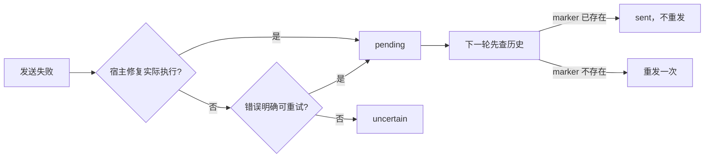

# 计划：修复 MiMo 自动重启后任务不再唤醒，并恢复 story/T17B

> **模板用法**：本计划存于 `docs/plans/2026-09-21-MiMo自动修复后唤醒重试.md`；用户审阅通过并输入 1 后，交执行者执行。
> **执行者开工指令**：阅读 `docs/plans/2026-09-21-MiMo自动修复后唤醒重试.md` 并严格执行。

## 0. 执行者须知（写给执行者）

1. 本文档自包含全部上下文，不依赖任何会话历史
2. 按任务顺序执行；每完成一项，将状态改为 `[x]` 并在“结果”栏一句话记录
3. 现场代码与本文档描述冲突时：**停下询问用户**，禁止自行发挥
4. 只做第 4 节任务清单内的事；发现“顺便可以改”的，记入第 7 节执行备注，不动手
5. 受第 5 节约束保护的内容，任何情况下不得修改

## 1. 背景与目标

- 为什么做：`story` 项目 T17B 在 2026-09-21 23:05 首次唤醒 MiMo 时遇到连接失败。服务成功自动重启 MiMo，但发送异常分支仍把通知记为 `uncertain`；下一轮状态机对 `uncertain` 明确禁止重发，因此任务一直未领取。

- 已核实证据：T17B attempt `76314787-2a6d-4ef6-8569-182ac58a417d` 的 `wakeNotice.status=uncertain`；同一任务存在 `wake_repair` 事件，结果为成功 `restart`；重启后的目标会话仍存在于正确工作区，但历史中没有 `TASK-DISPATCH-WAKE:76314787-2a6d-4ef6-8569-182ac58a417d`。这排除了“已送达但未领取”，证明自动修复后没有发生承诺的重试。

- 完成后的可观察效果：宿主发送失败且自动启动/重启成功时，通知回到可重试状态；下一轮重新读取新端口/令牌并只发送一次。自动修复未执行或送达仍无法确认时继续保持保守的 `uncertain`。当前 story/T17B 在不直接编辑 `state.json` 的前提下恢复唤醒。

## 2. 现状锚点（执行者必读）

| 位置 | 现状 | 作用 |
| --- | --- | --- |
| `runtime/core/wake.cjs` L75-L85 | `repair()` 只返回文案字符串，调用方不知道修复是否真的执行成功 | 本计划修改对象 |
| `runtime/core/wake.cjs` L151-L178、L218-L275 | 发送失败后仅依据 `error.safeToRetry` 选择 `pending/uncertain`；自动修复成功也会落到 `uncertain` | 根因位置，覆盖任务、提醒、planning、scope attention、task attention |
| `runtime/core/wake.cjs` L158-L166 | `sending/uncertain` 且历史无 marker 时禁止自动重发 | 正确的重复投递保护；不得整体移除 |
| `runtime/adapters/mimo-wake.cjs` L42-L59、L118-L154 | 每次请求重新读取 discovery，且发送后以会话历史确认 marker | 只读依赖，本计划不修改 |
| `tests/wake-repair.test.cjs` L69-L105 | 只覆盖 read 失败触发修复，没有覆盖 send 失败、修复成功、下一轮重发 | 本计划补充回归 |
| `D:/wjz/projects/godot/qwen/story/.task-dispatch/runtime/story-efca7e87/state.json` | T17B 当前为未领取、未结算、`wakeNotice=uncertain` | 工作空间外运行态；仅作核验，不直接写文件 |

- 构建/验证方式：项目根 `PROJECT.md` 指定在仓库根运行 Node.js 验证；包脚本为 `npm test`，定向测试可用 `node --test tests/wake-repair.test.cjs tests/wake.test.cjs tests/storage-usage-mimo.test.cjs`。

## 3. 方案与关键决策

- 总体思路：让 `repair()` 返回包含“展示文案”和“是否已实际启动/重启”的结构化结果。所有发送失败分支统一调用一个小型状态判定函数：`safeToRetry` 或自动修复已实际执行时为 `pending`，否则为 `uncertain`。下一轮仍先读取目标历史；若 marker 已存在则记为 `sent`，若不存在才允许重发，从而保留幂等保护。

- 决策记录：

  - 保留 `uncertain` 的禁止重发语义，因为无法确认送达时自动重发可能产生重复任务。
  - 只把 `repairBridge()` 返回 `attempted:true` 视为修复后的可重试依据；`rate-limited`、`status-unknown`、`session-active`、自动修复失败仍不可据此重发。
  - 用封装函数统一五类通知的状态选择，避免只修 T17B 普通任务而遗漏 reminder/planning/attention。
  - 当前 T17B 不直接改运行时状态文件；在再次确认 marker 不存在、attempt 仍未领取后，通过现有 MiMo adapter 投递原 marker，并由服务自己的历史核对把状态收敛为 `sent`。

## 4. 任务清单

### T1 修复自动修复后的通知状态转换

- 文件：`runtime/core/wake.cjs`

- 改动：让 `repair()` 返回结构化结果；新增可复用的失败状态判定；任务首次通知、人工/自动 reminder、planning、scope attention、task attention 的发送异常分支统一使用该判定。保留原错误文案、修复事件与幂等历史核对。

- 验收：自动修复 `attempted:true` 后通知为 `pending`；修复未执行且错误不具备 `safeToRetry` 时仍为 `uncertain`；已出现 marker 的通知不重复发送。

- 结果：`repair()` 已返回结构化的 `attempted/note`；所有发送异常分支统一使用封装判定，自动修复实际执行后进入 `pending`，其余不确定发送保持 `uncertain`。

- 状态：[x] 已完成

### T2 补充回归测试并验证

- 文件：`tests/wake-repair.test.cjs`，必要时仅在已有 wake 测试文件内补充最小覆盖

- 改动：新增“首次 send 失败 → 自动修复成功 → 状态 pending → 下一轮重新读取并成功发送”的测试；补充修复未执行仍 uncertain、历史已有 marker 不重发的断言。运行定向测试及全量 `npm test`。

- 验收：新增测试在旧实现上能暴露缺陷，在新实现上通过；现有唤醒、MiMo、管理台相关测试无回归；全量测试退出码为 0。

- 结果：已补自动修复后重试、未执行修复保持 uncertain、marker 去重三类断言；定向 38/38 通过。首次全量 221/222，唯一失败为随机端口监听 `EACCES`，该用例单独复跑通过；第二次全量 222/222 通过。

- 状态：[x] 已完成

### T3 恢复 story/T17B 的实际唤醒

- 文件：不直接修改任何文件；运行态目标为 `D:/wjz/projects/godot/qwen/story` 的 task-dispatch 服务与 MiMo 会话 `ses_ffe5f3bf2d428ffeeuy52Hevg5`

- 改动：确认 T17B 仍是当前未领取 attempt，目标会话仍属于 story 工作区且原 marker 仍不存在；使 story 项目服务加载修复后的代码；通过现有 MiMo adapter 向该会话投递同一个 T17B marker 一次。若任一前置条件变化则停止，不发送。不得直接编辑工作空间外的 `state.json`。

- 验收：MiMo 历史出现原 marker；服务把 T17B 通知识别为 `sent`，或目标会话完成 `claim` 并记录相同 attemptId；不创建新 attempt、不重复发送。

- 结果：story 服务已切换到新实例；前置核验通过后向原会话投递原 marker 一次。T17B 原 worker attempt 已被目标 MiMo 会话领取并提交，现进入 reviewer 阶段；历史中原 marker 恰好 1 条，未直接编辑 state.json。

- 状态：[x] 已完成

### T4 更新说明与计划执行记录

- 文件：`CHANGELOG.md`、本计划

- 改动：记录 MiMo 自动修复成功后会重新尝试原通知，以及未确认投递仍保持保守停止；回填任务结果、状态与执行备注。

- 验收：文档与实际状态机一致，UTF-8 无 BOM，中文未损坏。

- 结果：`CHANGELOG.md` 已记录修复语义；本计划已回填代码、测试、现场恢复和清理结果，涉及文档均保持 UTF-8 无 BOM。

- 状态：[x] 已完成

## 5. 约束

- 禁止修改：`runtime/adapters/mimo-wake.cjs` 的送达确认协议、story 项目业务文件、任何凭据/token、任何非 T17B 任务状态。

- 代码标记：新增非 MD 文档的代码加 `[AI-added]` + `2026-09-21`（精确到分钟），注释不含中文。

- 其他：不直接编辑工作空间外的运行时 `state.json`；不把所有 `uncertain` 粗暴改成可重试；不输出 discovery token；临时文件只放本项目 `tmp/` 并在结束时清理；现有文件保持原编码。

## 6. 整体验证

- 构建命令：无独立构建。

- 测试/运行命令：`node --test tests/wake-repair.test.cjs tests/wake.test.cjs tests/storage-usage-mimo.test.cjs`；`npm test`。

- 通过标准：所有测试通过；T17B marker 只出现一次且任务能被目标 MiMo 会话领取；未改 story 业务文件及运行时状态文件；服务没有新增 `uncertain` 循环或重复投递。

## 7. 执行备注（执行者回写）

- 当前目录未发现可用 `.git` 元数据，无法用 `git status/diff` 校验；执行时使用逐文件差异和测试结果核对改动范围。
- 若 story 服务无法安全重启，或 T17B 已被领取/替换/结算，停止 T3 并报告现场状态，不强制恢复旧 attempt。
- 服务收到优雅停止后由现有运行环境自动拉起新实例（PID 33016 → 18928），没有强杀进程。
- 两轮全量与定向测试在项目 `tmp/` 下生成的 171 个临时目录已按创建时间和根路径双重校验后清理，未删除此前内容。

## 生成/修改记录

| 时间 | 模型 | 操作 | 摘要 |
| --- | --- | --- | --- |
| 2026-09-21 23:33 | GPT-5 | 创建 | 定位 MiMo 自动修复成功后通知仍进入 uncertain 的状态机缺陷，并规划代码修复、回归与 T17B 恢复 |
| 2026-09-21 23:57 | GPT-5 | 修改 | 完成状态机修复、回归测试、story/T17B 单次恢复投递、全量验证与临时目录清理 |
