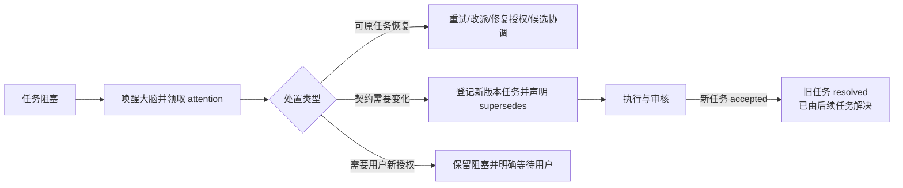

# 计划：治理历史阻塞标签并补全大脑的计划与解阻权限

> **模板用法**：本文档用于本次 task-dispatch 状态机改造；用户审阅通过并输入 1 后，交执行者执行。
> **执行者开工指令**：阅读 `docs/plans/2026-09-21-阻塞任务治理与大脑计划权限.md` 并严格执行。

## 0. 执行者须知（写给执行者）

1. 本文档自包含全部上下文，不依赖任何会话历史。
2. 按任务顺序执行；每完成一项，将状态改为 `[x]` 并在“结果”栏一句话记录。
3. 现场代码与本文档描述冲突时：**停下询问用户**，禁止自行发挥。
4. 只做第 4 节任务清单内的事；发现“顺便可以改”的，记入第 7 节执行备注，不动手。
5. 受第 5 节约束保护的内容，任何情况下不得修改。

## 1. 背景与目标

- 为什么做：管理端目前把后来已由返修/替代任务解决的旧任务永久显示为“阻塞”，并计入未完成数量；阻塞虽会唤醒大脑，但大脑凭据缺少部分正式处置动作；计划文档与已派发任务契约也没有清晰的可变性边界。

- 完成后的可观察效果：

  - 已由通过任务替代的旧阻塞任务显示为“已由后续任务解决”，不再制造红色异常或计入未完成数量。
  - 任意新的 `blocked` / `uncertain` 都形成大脑可领取的待办；大脑可以在身份权限内完成重试、改派、修复授权、候选协调、替代关系和关闭告警，不需要读取管理员令牌。
  - 大脑可修改未来计划和未开始任务；已产生 attempt 的任务契约保持冻结，变更必须建立新任务版本并显式替代旧任务，避免审核对象在途中漂移。

## 2. 现状锚点（执行者必读）

| 位置 | 现状 | 作用 |
| --- | --- | --- |
| `runtime/core/dispatcher.cjs` L42-L82 | 任务只有 `ready/running/review_ready/reviewing/accepted/blocked/uncertain`；项目结束要求全部任务为 `accepted` | 状态机、任务登记与收尾判定 |
| `runtime/core/dispatcher.cjs` L147-L154 | `docs/plans/` 等控制面变化会记录 `controlDrift` 并继续审核，业务文件变化才判 stale | 计划文件变化不应直接阻塞审核的既有机制 |
| `runtime/core/brain-attention.cjs` L8-L27 | `blocked/uncertain` 会形成大脑待办，但确认只消除通知，不处置任务 | 阻塞升级入口 |
| `runtime/core/desktop.cjs` L108-L128、L237-L255 | 大脑可改派、加额度和登记任务；同 ID 任务内容冲突直接拒绝 | 大脑现有权限与任务契约冻结点 |
| `runtime/core/monitor.cjs` L156-L199、`runtime/core/dashboard.cjs` L19-L35 | 所有 `blocked/uncertain` 都生成异常；未暴露替代/解决关系 | 管理端数据模型 |
| `runtime/console-web/app.js` L353-L366、`runtime/web/app.js` L121 | 非 `accepted` 都作为活动任务显示，阻塞统一用红色标签 | 用户看到大量历史阻塞的直接原因 |
| `runtime/catalog-console.cjs` L20 | `activeTaskCount` 把所有非 `accepted` 状态都计入未完成 | 首页统计误导来源 |
| `tests/brain-attention.test.cjs`、`tests/scope-recovery.test.cjs`、`tests/admin.test.cjs` | 已覆盖通知、控制面漂移和管理操作，但没有“替代任务解决旧阻塞”与大脑完整处置权测试 | 回归基线 |

- 构建/验证方式：项目根 `D:\wjz\ai\plugins\task-dispatch`；执行 `npm test` 与 `node scripts/verify.js`。

## 3. 方案与关键决策

- 总体思路：新增真实终态 `resolved`，而不是只在前端改文案。旧任务只有在一个显式关联的替代任务已经 `accepted` 后才可进入 `resolved`；状态保存替代任务、原因、时间和操作者。调度、依赖、项目完成、缓存保留、统计和管理端统一把 `accepted/resolved` 视为终态，但 UI 区分“已通过”与“已由后续任务解决”。

- 大脑权限模型：大脑是流程控制面的最高处置者，可对已结算的阻塞边界执行重试、改派、追加额度、修复授权、候选协调、修订未开始任务和建立替代关系；这些动作全部走 brain credential、服务端校验和事件审计。

- 计划可变性模型：

  - `docs/plans/` 与 `.task-dispatch/plan.md` 仍是大脑可写控制面；它们的变化只记录 `controlDrift`，不让既有候选失效。
  - 尚未产生 attempt 的 `ready` 任务允许显式修订，保存旧契约历史并递增 `contractRevision`。
  - 已产生 attempt 的任务禁止原地修改 `instructions/acceptance/allowedPaths/dependsOn`；大脑必须创建新任务 ID，并用 `supersedes` 指向旧任务。
  - 替代任务通过后由服务原子地把符合条件的旧 `blocked` 任务转为 `resolved`；不能按任务名或自然语言自动猜测替代关系。

- 决策记录：

  - 选定核心状态 `resolved`，因为单纯改前端标签会继续污染未完成计数、项目结束条件和告警。
  - 选定“替代任务 accepted 后才自动解决旧阻塞”，因为大脑应能改计划，但不能无证据地把失败任务伪装成通过。
  - 选定显式 `supersedes` 关系，不从 `-R1/-R2` 命名推断，避免误关联。
  - 允许大脑修改未来计划和未开始任务；否决“任意时刻原地改已派发契约”，因为会让 worker、reviewer 和候选快照依据不同版本验收。
  - 大脑的最高权力限于已获用户授权的工作流控制面；不得绕过付费/外部调用授权、直接把未审核实现标为 `accepted`、覆盖在途 attempt 或在未确认旧进程停止时强行清除 `uncertain`。

## 4. 任务清单

### T1 建立终态与替代关系模型

- 文件：`runtime/core/dispatcher.cjs`、按复用需要新建 `runtime/core/task-state.cjs`、`runtime/core/planning.cjs`、`runtime/core/maintenance.cjs`、`runtime/catalog-console.cjs`

- 改动：封装终态判断；任务登记支持可选 `supersedes`；校验替代目标存在、不是自身、没有循环且当前不是已通过终态。替代任务达到 `accepted` 后，原子地将已结算且处于 `blocked` 的目标转为 `resolved`，保存 `resolution` 审计字段并确认旧 attention。依赖满足、项目完成、活动计数、规划收尾与缓存保留统一使用终态 helper。

- 验收：通过的替代任务能解决旧阻塞；替代任务未通过、目标在途、目标为 `uncertain` 且未确认停止、目标已经 `accepted/resolved` 或关系非法时不得误改状态；现有无 `supersedes` 任务行为不变。

- 结果：新增统一终态 helper、`resolved` 审计模型与显式 `supersedes`；替代任务通过后原子收束旧 blocked，依赖、项目结束、规划、缓存和目录统计均统一识别终态，并拒绝在途、重复或循环替代关系。

- 状态：[x] 已完成

### T2 补全大脑的阻塞处置权限

- 文件：`runtime/core/desktop.cjs`、`runtime/desktop-client.cjs`、`runtime/server.cjs`、`runtime/core/brain-attention.cjs`、必要时 `runtime/core/dispatcher.cjs`

- 改动：为 brain credential 提供受校验的 `retry`、`configure-repair`、`reconcile-review`、`revise-task` 与替代/解决相关入口；复用现有 dispatcher 校验，不复制状态变更逻辑。`task_attention` 提示返回当前可用动作和缺失前提。未开始任务修订保存 `instructionHistory/contractRevision`；已开始任务返回明确错误并要求新版本任务。

- 验收：非 brain 调用全部拒绝；brain 无需管理员令牌即可疏通合法阻塞；所有动作有事件、原因和幂等/陈旧状态保护；任何动作都不能直接伪造 `accepted`。

- 结果：brain credential 已具备受服务端校验和事件审计的 retry、configure-repair、reconcile-review、revise-task、resolve-task；HTTP 与 CLI 入口齐全，非 brain 调用拒绝，attention 提示列出合法处置路径与授权边界。

- 状态：[x] 已完成

### T3 修正管理端标签、统计与操作入口

- 文件：`runtime/core/monitor.cjs`、`runtime/core/dashboard.cjs`、`runtime/console-web/app.js`、兼容管理页 `runtime/web/app.js`、`runtime/wizard.cjs`、相关 HTML/CSS（仅在确有展示需要时）

- 改动：监控快照暴露 `supersedes/resolution/contractRevision/attention`；`resolved` 显示“已由后续任务解决”，使用非错误终态样式，详情展示替代任务与原因。默认“进行中与异常”过滤器排除 `accepted/resolved`；首页未完成数排除二者；已解决任务不再生成 blocked 告警或提供重试/改派按钮。阻塞任务详情提供与当前状态匹配的大脑处置说明/入口。

- 验收：历史失败仍可在“所有任务”中审计，但不会看起来仍在阻塞项目；实时与只读汇总管理端展示一致；无解决证据的阻塞仍保持红色告警。

- 结果：监控与只读快照暴露替代、解决、契约版本和 attention；两套管理页、向导与项目目录统一显示“已由后续任务解决”，默认活动列表和异常排除 accepted/resolved，详情保留替代证据。

- 状态：[x] 已完成

### T4 固化计划修订和审核不漂移规则

- 文件：`runtime/core/contracts.cjs`、`runtime/core/scope-recovery.cjs`、`runtime/core/dispatcher.cjs`、技能与运行文档中直接相关段落

- 改动：任务 prompt/attempt 记录 `contractRevision`；审核使用派发时冻结的任务契约。保持 `docs/plans/` 控制面漂移可继续审核，并在事件/详情中明确记录；业务文件和当前任务执行回执的晚到变化仍阻塞，避免把审核输入变化误当作普通计划变化。文档明确“大脑可改计划、不可原地改在途任务契约”的边界。

- 验收：大脑修改计划文件不会使候选 stale；修改业务文件或审核输入仍会阻塞；未开始任务修订后 worker 获得新契约版本；在途任务修订被拒并引导创建替代任务。

- 结果：任务 prompt 与 attempt 固化 `contractRevision`；未开始任务显式修订并保留历史，在途任务拒绝原地改约；控制面漂移仍可续审，业务文件与审核输入变化仍按既有严格规则阻塞。

- 状态：[x] 已完成

### T5 回归测试与现有项目迁移指引

- 文件：新增或修改 `tests/*.test.cjs`、`docs/runtime.md`、`docs/admin-console.md`、`CHANGELOG.md`

- 改动：覆盖 resolved 终态、替代自动收束、非法替代、依赖/完成条件、brain 权限、契约修订、控制面漂移和 Web 标签。提供现有项目迁移操作：部署新 runtime 后，由原 brain 显式登记旧阻塞与已接受替代任务的关系；不自动按名称猜测，也不直接编辑 `state.json`。

- 验收：`npm test` 全部通过；`node scripts/verify.js` 通过；文档给出 novel2comic 中 D08、D08-R1、M2 等历史阻塞如何安全关联到已接受替代任务的示例，但本任务不直接修改 novel2comic 的服务状态。

- 结果：新增 resolved/替代关系/brain 权限/HTTP 路由/管理端标签与统计测试；`npm test` 218/218 通过，`node scripts/verify.js` 通过；运行文档给出 D08、D08-R1、M2 的证据化迁移示例且未修改 novel2comic 状态。

- 状态：[x] 已完成

## 5. 约束

- 禁止修改：`D:\wjz\ai\plugins\novel2comic\` 及其 `.task-dispatch/runtime/` 状态；未经用户另行确认，不迁移或修正真实项目数据。

- 代码标记：新增非 MD 文档代码加 `[AI-added] 2026-09-21 HH:mm`；注释不含中文。

- 权限边界：大脑的控制面最高权力不覆盖用户授权、外部调用/费用授权、操作系统权限、审核证据真实性与 `uncertain` 的旧进程确认。

- 编码：所有新建/修改的 md、js、json、txt 保持 UTF-8 无 BOM；修改前若发现非 UTF-8 文件，按 AGENTS.md 的二进制编码确认流程处理。

- 兼容：已有 state.json 无 `resolution/supersedes/contractRevision` 时按旧任务正常读取；禁止要求用户手改状态文件。

- 临时文件：只放 `D:\wjz\ai\plugins\task-dispatch\tmp\`，验证结束清理本任务新增临时目录。

## 6. 整体验证

- 构建命令：无独立构建目录；在项目根执行 `npm test`。

- 测试/运行命令：`node scripts/verify.js`；按新增测试文件使用 `node --test tests/<文件>.test.cjs` 做定向回归后再跑全量。

- 通过标准：

  - 所有测试与 skill 校验通过。
  - `resolved` 在调度、依赖、完成、清理、管理端统计和告警中的语义一致。
  - 新阻塞必达大脑；大脑能在无需管理员令牌的情况下完成合法处置。
  - 计划文件更新不阻塞候选；在途任务契约不可被静默改写。
  - 未经替代任务通过或显式安全前提，不得把阻塞改成已解决。

## 7. 执行备注（执行者回写）

- 当前 novel2comic 中历史 `blocked` 与后续 `accepted` 任务只有人为可识别的命名/文档关系，没有结构化替代字段；迁移必须由大脑显式确认映射。
- 现有代码已经允许 `docs/plans/` 控制面漂移继续审核；本次重点是把这条规则与任务契约版本、管理端解释统一起来，而不是粗暴排除整个文档目录。
- 全量回归最初暴露 `tests/wizard.test.cjs` 依赖开发机全局项目目录为空；测试已改为使用隔离空索引，避免真实登记项目造成环境相关失败，未修改任何真实目录数据。
- `scripts/verify.js` 按其既有行为在系统临时目录保留校验夹具；受“工作空间外修改需确认”约束，本次未擅自删除该目录。

## 生成/修改记录

| 时间 | 模型 | 操作 | 摘要 |
| --- | --- | --- | --- |
| 2026-09-21 09:14 | GPT-5 | 创建 | 初版：阻塞终态、brain 解阻权限、计划版本与管理端标签治理 |
| 2026-09-21 10:02 | GPT-5 | 完成 | T1-T5 全部实现；全量 218 项测试与技能校验通过 |
