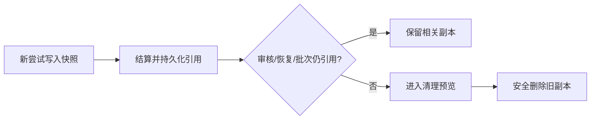

# 计划：项目缓存迁移、安全回收与 Web 统计收纳

## 0. 执行者须知

1. 本计划基于当前源码与 2026-09-24 的只读检查，自包含上下文，不依赖历史任务记录。
2. 先取得用户对方案的确认。项目外的旧服务迁移、停止及删除需取得明确的边界确认。
3. 每完成一项更新对应任务日志和技术方案文档；发现现场代码与锚点不符时重新分析。

## 1. 背景与目标

- `C:\Users\Lenovo\.task-dispatch-service` 当前仍由旧连接使用，服务进程运行中，项目目录表也将 `D:\wjz\proj\3dPrinter\Cura\HYAlgLib` 指向它。该目录中 `artifacts` 约 460.5 MiB、`reviews` 约 190.8 MiB；项目内默认运行目录尚不存在。
- 该服务有两项已通过任务，共 11 次尝试。默认策略是保留 7 天且保留最近 2 项已通过任务；当前实现按任务整体保护所有历史尝试，故这两项任务的旧副本都不能清理。
- Web 的“返工、用量与批次”在统一控制台和直连管理台中每次刷新都完整展开。
- 完成效果：新服务位于项目内；迁移后的旧路径连接受到检查；新尝试安全落盘后可回收无活跃引用的旧副本；统计区域默认紧凑，展开后能查看完整内容，刷新不丢失展开状态。

## 2. 现状锚点

| 位置 | 当前实现与作用 |
|------|----------------|
| `runtime/core/data-root.cjs` 的 `resolveDataRoot` | 显式 `--data`、凭据目录优先于项目内默认目录；这解释了旧绑定继续使用 C 盘 |
| `runtime/migrate-data.cjs` | 已有停机、校验、复制并改写路径的迁移工具；源目录默认保留 |
| `runtime/core/data-root.cjs` | 新增迁移后旧用户目录路径检查，防止旧邀请重新初始化服务 |
| `runtime/core/maintenance.cjs` 的 `plan/apply` | 最近 2 项终态任务的全部尝试引用整体受保护；只立即清理验证树 |
| `runtime/core/dispatcher.cjs` 的 `execute/settle` | 工作快照用于 diff，审核需要最新工作基线和候选；结算前不可删除 |
| `runtime/core/batch-review.cjs` | 活动批次会引用成员候选、批次基线和复合候选 |
| `runtime/console-web/app.js`、`runtime/web/app.js` 的 `renderEvidenceSummary` | 两处均将所有明细直接插在概览统计后 |
| `tests/storage-usage-mimo.test.cjs`、`tests/data-migration.test.cjs` | 已有清理和迁移行为测试，可扩充关键回归场景 |

- 构建/验证：按 `PROJECT.md` 在项目根目录运行 Node.js 命令。

## 3. 方案与关键决策

### A. 缓存位置

| 方案 | 思路与影响面 | 风险 |
|------|--------------|------|
| **A1 推荐：停旧服务后用现有迁移工具搬到项目内** | 校验源服务只含该项目；停机后预览、复制并验证，更新目录表；新凭据使用项目内路径；验证新服务后再单独处理旧目录 | 迁移需要项目外读写与短暂停机；旧会话中的绝对路径需要换用新凭据 |
| A2：继续使用旧服务，仅修正回收 | 无迁移步骤，仍占用用户目录 | 不能满足不再写入 C 盘的目标 |

### B. 重复副本回收

| 方案 | 思路与影响面 | 回归风险 |
|------|--------------|----------|
| **B1 推荐：按活跃引用保留** | 保留未结算尝试、当前候选、最近工作基线、范围恢复与活动批次所需快照；旧的已结算尝试副本在安全边界进入清理预览，最近已通过任务仅保留当前候选；保留现有天数策略管理最终候选 | 引用漏算可能破坏审核、恢复或批次；以对应测试覆盖并保留 `safeTarget` 校验 |
| B2：只缩短 `retainDays` 或调低 `keepLatestAccepted` | 改配置，代码改动少 | 活动任务和最近两项任务仍按整体保护，无法解决重复尝试占用 |
| B3：每次新快照写入后直接删除上一份 | 实现简单，释放快 | 可能删掉尚待审核、持久回执重放、范围恢复或批次引用，风险高 |

### C. Web 展示

| 方案 | 思路与影响面 | 风险 |
|------|--------------|------|
| **C1 推荐：紧凑摘要 + 原生折叠明细** | 默认只显示返修数、计量覆盖与批次状态；展开查看原有全部指标；统一控制台和直连管理台一致，刷新保留状态 | 需核对长文本和小屏布局 |
| C2：移到独立页签 | 概览最简洁 | 增加导航和发现成本，改动范围更大 |

## 4. 任务清单

### T1 旧服务位置处理

- 范围：`runtime/migrate-data.cjs` 现有工具与项目外旧服务、项目内目标目录。
- 动作：确认目标目录与服务状态，按用户边界许可先迁移预览；若获许可，停机后执行迁移并校验新服务。旧源仅在新服务与凭据验证后另行清理。
- 实施补充：迁移时不改写快照与审核树中的 JSON，保证副本字节和快照哈希不变；旧连接若仍使用用户目录路径，将提示使用项目内目录。
- 验收：新凭据和项目目录表指向项目内运行目录；不会在旧 C 盘服务继续生成副本。
- 结果：服务已迁移并启动；1051 个树文件逐项哈希一致；新服务目录表、凭据和任务状态已核对。用户改为自行删除停用的旧 C 盘目录。
- 状态：[x] 已完成（旧源删除由用户处理）。

### T2 引用安全的滚动清理

- 文件：`runtime/core/maintenance.cjs`、相关测试。
- 改动：区分活动引用、可回收历史副本及保留策略下的最终候选；保留范围恢复、未结算回执、审核与批次必要文件；通过现有清理预览、路径校验与自动维护执行。
- 验收：重复尝试后旧副本可预览回收；活跃 diff、恢复、批次和最终候选能正常运行。
- 结果：引用安全的滚动清理已实施，真实服务预览 651 MiB 中约 575 MiB 可回收；迁移服务启动后剩余约 76 MiB。
- 状态：[x] 已完成。

### T3 Web 统计区域收纳

- 文件：`runtime/console-web/app.js`、`runtime/console-web/style.css`、`runtime/web/app.js`、`runtime/web/style.css`。
- 改动：生成紧凑摘要和折叠明细，保留当前展开状态与明细内容。
- 验收：默认显示一行摘要；可用鼠标和键盘展开；刷新不重置；两套界面一致。
- 结果：两套页面均实现默认收起的紧凑摘要；统一控制台已在浏览器中验证展开与刷新状态。
- 状态：[x] 已完成。

### T4 构建与回归

- 文件：相关测试及伴随文档。
- 动作：按项目命令验证缓存引用、迁移和页面脚本，并记录结果。
- 验收：Node.js 语法检查、相关测试及项目验证命令通过。
- 结果：`npm test` 256/256 通过，`npm run verify:skill` 通过，全部改动 JS 文件 `node --check` 通过。
- 状态：[x] 已完成。

## 5. 约束

- 不读取或引用历史日志、历史计划和总结内容。
- 用户曾明确授权停止和迁移旧服务；其后表示将自行删除旧 C 盘目录，因此该目录保留为已停用状态。
- 新增代码使用 `[AI-added]` 与精确到分钟的时间标记，代码注释不含中文；保持现有文件编码。
- 状态、收据和审计记录保留；仅清理由策略允许且无活跃引用的副本。

## 6. 整体验证

- 构建目录：`.`。
- 命令：`npm test`、`npm run verify:skill`，并对改动的 JavaScript 文件运行 `node --check`。
- 通过标准：测试通过；清理预览符合安全引用；Web 折叠可用；迁移完成时目录表和新凭据指向项目内路径。

## 7. 执行备注

- 用户未提供额外复现或测试命令。
- 外部数据迁移与源目录清理曾需要单独的边界授权；用户已授权迁移，旧服务已停止并完成迁移，旧源由用户自行删除。
- 方案确认前的清理与迁移相关基线测试为 18/18 通过。
- 迁移工具原先会改写快照树内的 JSON；实施中加入元数据过滤并以不可解析业务 JSON 测试覆盖。
- 统一控制台的浏览器实测确认了默认收起、展开明细和刷新后状态保留。

## 生成/修改记录

| 时间 | 模型 | 操作 | 摘要 |
|------|------|------|------|
| 2026-09-24 10:40 | GPT-6 | 创建 | 基于当前代码与服务元数据形成待审方案 |
| 2026-09-24 10:43 | GPT-6 | 更新 | 补充基线测试结果 |
| 2026-09-24 11:17 | GPT-6 | 更新 | 记录实施、迁移验证与用户自行删除旧源的决策 |
