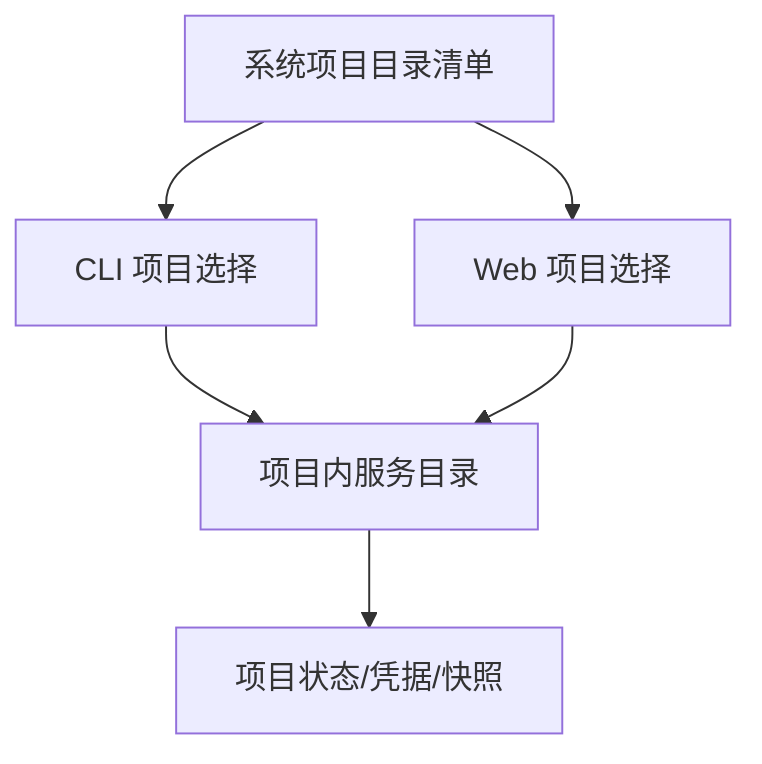

# 系统项目目录清单与 Web 管理端 — 技术方案

> 本文为历史方案记录。旧目录发现、迁移、旧页面与旧接入命令已移除；当前行为和接入步骤以 [运行文档](../runtime.md) 为准，完整现行数据继续使用，不自动补齐或迁移。

## 1. 需求概述

- **功能目标**：系统缓存仅维护全部项目的无凭据目录清单；命令行和 Web 管理端无需用户传入 `--workspace` 即可列出并选择项目。
- **验收标准**：多项目可从统一入口选择；项目状态与角色凭据仍位于各自工作目录；离线或失效项目有明确状态；迁移不强制输入工作目录。
- **需求来源/提出人**：用户反馈当前 `--workspace` 设计与总目录清单目标冲突，并明确要求 Web 管理端支持。

## 2. 影响面分析

| 涉及项 | 类型（模块/文件/接口） | 影响说明 |
|--------|------------------------|----------|
| 服务注册表 | 数据结构/模块 | 从服务根目录索引升级为以项目为核心的目录清单 |
| 命令行管理台 | 入口 | 无参数时展示并选择项目，不再要求 `--workspace` |
| Web 管理端 | 页面/接口 | 展示目录、刷新状态并进入所选项目服务 |
| 迁移工具 | CLI | 从旧服务状态自动获取唯一工作目录 |

## 3. 边界与异常场景

| 场景 | 预期行为 |
|------|----------|
| 清单为空 | 展示尚无项目以及首次接入指引，不创建用户级公共服务 |
| 多个项目 | 展示项目列表并要求选择，不要求手工输入路径 |
| 项目服务离线 | 仍显示目录项，并允许按项目启动或查看离线状态 |
| 工作目录已移动/删除 | 标记失效，不猜测新路径、不删除数据 |
| 旧版服务索引 | 兼容读取并从服务状态补全项目条目 |
| 清单损坏 | 明确报错或降级展示可验证项目，不暴露令牌 |

## 4. 技术方案

- **选定方案**：系统项目目录清单作为正常发现入口，`--workspace`/`--data` 仅保留兼容和诊断用途；Web 管理端增加项目目录页。
- **被否决方案**：多项目时继续要求用户传 `--workspace`，因为它重复索引数据并容易选错项目。

### 关键设计

- 清单项目条目保存项目标识、规范化工作目录、项目内数据目录、登记与最近发现时间，不保存管理令牌或角色凭据。
- Web 目录接口只返回无敏感信息的项目定位与在线状态；实际项目管理请求仍由对应项目服务鉴权处理。
- 旧索引通过读取已登记服务状态生成兼容项目视图，后续注册时写入新版结构。

## 5. 实现流程（必填章节）

1. 服务注册或迁移完成时，将项目与其工作目录、项目内数据目录写入版本 2 系统目录清单。
2. `catalog()` 同时读取新版项目条目和旧版服务条目，并用可验证的服务状态补全项目 ID。
3. CLI 管理入口无参数列出项目；Web 启动器无参数选择一个有效服务作为全局汇总入口。
4. Web 汇总页保留失效项目提示；用户打开其他项目时，当前服务启动或复用目标服务，请求一次性登录票据并跳转。
5. 迁移工具从旧服务状态读取唯一工作目录，`--workspace` 仅保留为显式一致性校验。

### 无项目目录态

- CLI 管理入口在清单为空时进入刷新/退出菜单，不解析或初始化任何服务数据目录。
- Web 无参数入口启动独立的内存态目录进程，只读取 `service-registry.json` 和各项目公开状态摘要；空清单也返回完整主页。
- 目录页面每 2 秒刷新项目存在性、在线状态和任务计数。项目出现后可启动或复用其项目内服务，再通过一次性票据跳转到完整管理台。
- 目录登录票据、会话和 CSRF 信息只在进程内存中存在，不写入系统缓存；关闭目录窗口不影响项目服务。

## 6. 验证方式

- **用户提供的验证方法**：不传 `--workspace`，CLI 和 Web 管理端均能列出并选择所有项目工作目录。
- **构建验证**：`npm test` 174/174 通过；`node scripts/verify.js` 全部通过。
- **验证结论**：空系统 CLI/Web 入口、动态加入项目与任务、多项目目录、跨服务项目打开、失效项目展示、旧索引兼容和无 workspace 迁移均有回归覆盖并通过。

## 7. 遗留问题与后续计划

- 无。

## 生成/修改记录

| 时间 | 模型 | 操作 | 摘要 |
|------|------|------|------|
| 2026-09-17 13:52 | GPT-5 | 创建 | 建立总目录清单与 Web 管理端技术方案初稿 |
| 2026-09-17 14:04 | GPT-5 | 更新 | 补全实现流程与验证结论 |
| 2026-09-17 14:23 | GPT-5 | 更新 | 增加空系统 CLI/Web 目录态与动态刷新设计 |
| 2026-09-17 14:28 | GPT-5 | 更新 | 补充空目录动态刷新实现与验证结论 |
