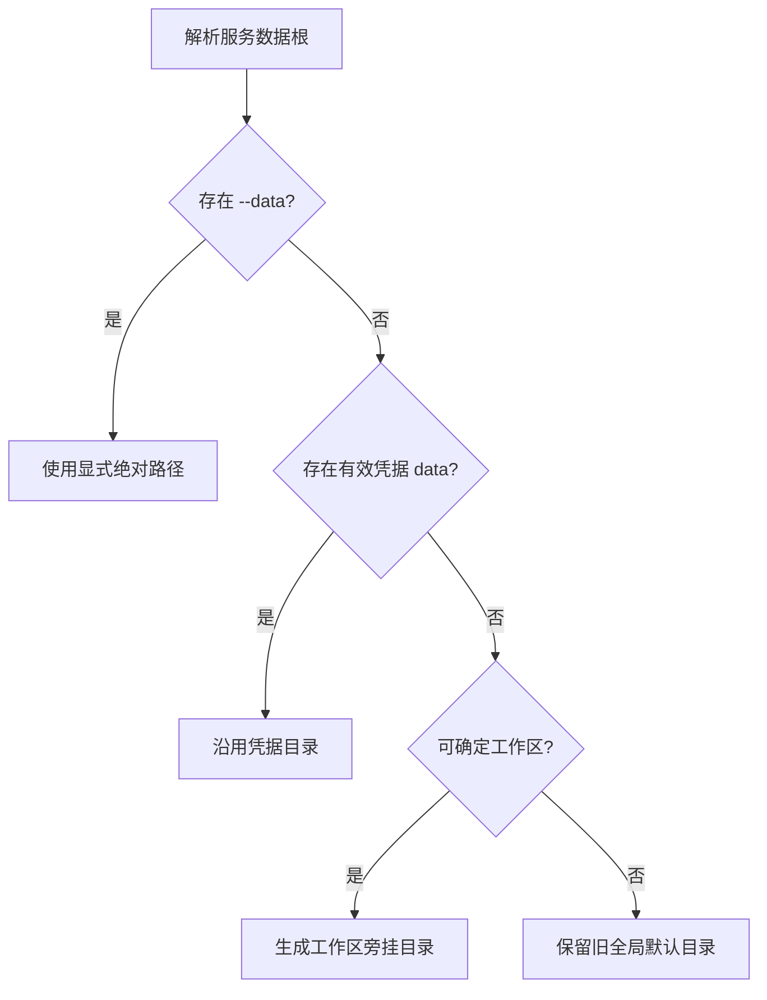

# 项目级服务数据目录 — 技术方案

## 1. 需求概述

- **功能目标**：桌面项目在未显式指定 `--data` 时，将服务状态、连接凭据和缓存写入工作区旁的项目独立目录，不再默认混放到用户目录下的全局 `.task-dispatch-service`。
- **验收标准**：不同工作区得到不同且稳定的数据目录；目录不位于源码工作区内部；显式 `--data` 和已有凭据保持兼容；停止项目服务后可删除对应目录完成独立重置。
- **需求来源/提出人**：用户提出。

## 2. 影响面分析

| 涉及项 | 类型（模块/文件/接口） | 影响说明 |
|--------|------------------------|----------|
| 数据根解析 | 核心模块 | 新增统一解析器，定义显式参数、凭据、工作区和旧默认值的优先级 |
| 桌面客户端 | 命令入口 | connect/discover 使用项目旁挂目录，后续命令沿用凭据目录 |
| 安装链接 | 数据结构 | 从固定 `data` 路径升级为工作区解析模式，同时兼容旧链接 |
| Qoder Hook | 平台入口 | 使用运行层统一解析规则，不自行拼接固定全局路径 |
| 文档与测试 | 用户接口 | 更新默认行为、删除边界和兼容说明 |

## 3. 边界与异常场景

| 场景 | 预期行为 |
|------|----------|
| 显式传入 `--data` | 始终使用用户指定目录 |
| 命令携带已有凭据但未传 `--data` | 使用凭据内记录的原数据目录 |
| 新 connect/discover 未传 `--data` | 按工作区生成旁挂独立目录 |
| 同名项目位于不同路径 | 路径短摘要保证目录名不同 |
| 无法确定工作区的旧管理命令 | 保留用户目录全局默认值，避免无依据猜测 |
| 删除数据目录时服务仍运行 | 文档明确禁止；必须先停止服务并结束在途任务 |
| 用户已有全局目录 | 不迁移、不删除；显式路径和旧凭据继续可用 |

## 4. 技术方案

- **选定方案**：项目旁挂独立目录。目录命名复用 `workspaceKey`，服务数据仍位于工作区之外。
- **被否决方案**：项目内部目录会污染源码并触发快照、Git 和凭据边界问题；自动迁移旧全局目录会引入共享状态和产物引用的事务风险。

### 关键设计

解析优先级如下：

安装链接使用版本化的 `dataMode` 描述默认解析模式，不保存某个项目的数据目录。运行层仍接受旧版链接的固定 `data` 字段。

## 5. 实现流程

1. 新增无副作用的数据根解析模块，封装参数解析、凭据读取和旁挂目录生成。
2. 桌面客户端在校验 provider 后、创建服务前解析最终数据根；连接和发现传入工作区，普通命令读取凭据。
3. 安装器写入新版工作区模式链接；Qoder Hook 复用同一运行层解析函数。
4. 更新帮助和接入文档，明确旧数据兼容及删除前停服要求。
5. 增加解析、安装和桌面连接回归测试，执行全量测试与验证脚本。

实现完成后，`wizard.dataRoot` 同时支持 `--workspace`，因此看板和清理入口可在不手写旁挂目录名的情况下定位项目服务。Qoder/QoderCN 安装载荷继续排除退役 Hook，只安装常驻 App Plugin 桥接；Hook 源码仅保留旧环境兼容。

## 6. 验证方式

- **用户提供的验证方法**：未提供。
- **构建验证**：项目无独立构建目录；`npm test` 通过，153/153；`node scripts/verify.js` 通过。
- **验证结论**：项目隔离、真实默认 connect、显式路径覆盖、旧凭据目录、安装链接升级、Qoder 桥接安装及全量回归均通过。

## 7. 遗留问题与后续计划

- 本次不自动迁移现有全局服务目录；如需保留并拆分历史记录，应另做带预览和回滚能力的迁移功能。

## 生成/修改记录

| 时间 | 模型 | 操作 | 摘要 |
|------|------|------|------|
| 2026-09-16 16:00 | GPT-5 | 创建 | 建立项目级服务数据目录技术方案初稿 |
| 2026-09-16 16:08 | GPT-5 | 更新 | 补全实现细节与验证结论 |
