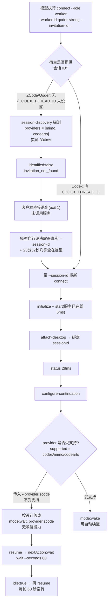

# 执行员接入（connect/resume）耗时长诊断

- 诊断时间：2026-09-15 17:30 ~ 17:35（本地 UTC+8）
- 诊断对象：`desktop-86178cf8a25e9d42`（工作区 `D:\wjz\proj\plugins\task-dispatch`），worker `qoder-strong` 的接入过程
- 服务版本：0.6.0；服务进程 pid 68112，端口 61752（存活）
- 结论一句话：**connect 脚本本身只花 1~2 秒就能跑完，慢的不是脚本。时间花在两处——接入前的"会话身份识别"（约 24 分钟空转）和接入后的"无唤醒适配器，只能 wait 轮询 60 秒一轮"。**

---

## 一、结论

| 现象 | 实际原因 | 性质 |
|---|---|---|
| 从邀请生成到执行员真正 attach 之间隔了 23 分 52 秒，服务端全程无事件 | Qoder/ZCode 宿主没有会话发现适配器，`--invitation-id` 必然识别失败（客户端在调用服务前就退出），只能由模型自己去找真实 `--session-id` | 能力缺失，非卡死 |
| attach 之后界面/会话看起来"一直在连接、不结束" | 该宿主无唤醒适配器，`continuation` 落成 `{mode:'wait'}`，`resume` 每轮执行 `wait --seconds 60` 后返回 `idle:true`，需要反复 resume | 设计行为，非卡死 |
| 即使一直 resume 也领不到任务 | 项目 `startup.state = "waiting"`、`tasks = 0`，大脑尚未 `start-work --confirmed` 与 plan，claim 无 job 可发 | 流程未推进，非故障 |

**当前实际状态**：worker 已接入成功（09:32:10Z / 17:32:10），并有一个 `wait` 进程在跑（`.wait.lock` PID 59576，17:32:32 启动）。这不是故障，是等待循环的正常表现。

---

## 二、实测耗时（全部为只读探测）

| 阶段 | 实测耗时 | 结果 |
|---|---|---|
| `discover-session --invitation-id` | **336 ms** | `identified:false`，`invitation_not_found`；mimo 可达无匹配、codearts 不可达 |
| 服务在线检查 `start(root)` | **6 ms** | 已在线，直接返回 |
| 管理端 `GET /status`（state.json 273 KB） | **28 ms** | 3 个项目、128 条事件 |
| `POST /desktop`（无效令牌探测服务响应） | **29 / 2 / 1 ms** | 服务事件循环未被阻塞 |
| Codex 唤醒管道发现 `CodexWake.discover()` | **265 ms** | 找到管道 `\\.\pipe\codex-browser-use-f41358cc-...` |
| `CodexWake.read(未知 threadId)` | **462 ms** | 失败：`Desktop call failed` |
| MiMo `sessions()` 列表 | **44 ms** | 6 个会话 |
| MiMo `messages(单个会话)` | **19 ms** | 正常返回 |
| CodeArts `sessions(workspace)` | **1 ms** | 失败：`CodeArts project bridge unavailable` |

把这些加起来，正常情况下 connect 应该在 **2 秒以内**结束。所以"连接很久"与脚本各阶段耗时无关。

---

## 三、connect 实际流程与耗时分布



### 关键时间线（服务端事件流）

| 本地时间 | UTC | 事件 |
|---|---|---|
| 17:07:49 | 09:07:49.047Z | `project_registered` |
| 17:07:49 | 09:07:49.051Z | brain `desktop_attached` |
| 17:08:19 | 09:08:19.114Z | `staffing_assessed`，产出 qoder-strong（strong）邀请 |
| 17:13:46 | 09:13:46.005Z | reviewer `desktop_attached` |
| — | — | **空白 23 分 52 秒，服务端无任何事件** |
| 17:32:10 | 09:32:10.771Z | worker `desktop_attached`（clientId `f6d23ec8-...`） |
| 17:32:32 | — | worker 启动 `wait` 进程（PID 59576） |

```mermaid
%%{init: {'theme':'neutral'}}%%
gantt
    dateFormat HH:mm:ss
    axisFormat %H:%M
    title 接入时间线（本地时间）
    section 服务端事件
    邀请已生成(17:08:19)      :milestone, m1, 17:08:19, 0m
    执行员attach(17:32:10)    :milestone, m2, 17:32:10, 0m
    section 空白期
    无事件空转23分52秒        :active, 17:08:19, 23m52s
    section 接入后
    wait轮询(60s一轮)         :17:32:32, 3m
```

---

## 四、根因（含代码位置）

### 1. 会话身份识别：Qoder/ZCode 没有探测适配器

`runtime/core/session-discovery.cjs:12` 默认只探测两个宿主：

```js
const providers = !provider || provider === 'auto' ? ['mimo','codearts'] : [provider];
```

Qoder 与 ZCode 都不在列表里，且二者都不提供 `CODEX_THREAD_ID` 这类会话 ID 环境变量（实测本机环境无该变量）。因此 `--invitation-id` 在这类宿主上**必然失败**，实测返回：

```json
{"identified":false,"nextAction":"attention","reason":"invitation_not_found",
 "checks":[{"provider":"mimo","status":"checked"},{"provider":"codearts","status":"unavailable"}]}
```

而客户端在识别失败时会**在调用服务之前就退出**（`runtime/desktop-client.cjs:51-55`）：

```js
if (command === 'discover-session' || !discovered.identified) {
  console.log(JSON.stringify(discovered));
  if (!discovered.identified) process.exitCode = 1;
  return;
}
```

这解释了为什么 24 分钟里服务端一条事件都没有：请求根本没到服务，全部时间消耗在模型自己获取真实会话 ID 上。邀请文案中"无需自行寻找会话 ID"对 Qoder/ZCode 宿主不成立。

### 2. 唤醒适配器：`zcode` 不受支持，静默降级为 wait

`runtime/core/continuation.cjs:13-17`：

```js
const supported = ['codex', 'mimo', 'codearts'];
if (selected && selected !== 'auto' && !supported.includes(selected)) {
  if (!/^[a-z][a-z0-9-]{0,63}$/.test(selected)) throw Error('Invalid host provider');
  desktop.store.change(s => { ...continuation = {mode:'wait',provider:selected}; });
  return {mode:'wait', provider:selected, ...desktop.nextStep(identity)};
}
```

本次 worker 实际绑定结果（服务端 state.json）：

```
worker:qoder-strong | sessionId sess_a6facc6a-8712-442c-aff7-967f2c86ae72
                    | wake: 无
                    | continuation: {"mode":"wait","provider":"zcode"}
```

注意：代码中的 `zcode` 存在两套完全不同的东西，不要混淆——`runtime/adapters/agents.cjs` 里的 `zcode` 是**执行适配器**（拉起 `zcode app-server --stdio` 跑模型调用），而 `continuation.cjs` 的 `supported` 是**唤醒适配器**（原会话唤醒）。唤醒侧目前没有 zcode/qoder。

### 3. 无 wake 绑定 → 必然进入 wait 轮询

`runtime/core/desktop.cjs:172`：

```js
return {nextAction:'wait',nextInstruction:'本端未启用唤醒。持续协作期间提交后实际调用 wait --seconds 60 ... idle:true 不是完成，按授权续等；completed:true 才结束。'};
```

客户端 `wait` 默认 `--seconds 60`（`runtime/desktop-client.cjs:205`），服务端为 20 秒有界长轮询、每 250 ms 试一次 claim（`runtime/server.cjs:84`）。结果就是：`resume` → 60 秒 → `idle:true` → 再 `resume`，周而复始。

### 4. 项目未启动，claim 永远空

服务端状态：`startup.state = "waiting"`、`tasks = 0`。按 `connection.md`，`waiting` 时不得派单；`desktop.plan()` 也会 `assertStarted` 拦截。所以在大脑执行 `start-work --confirmed` 并 plan 出任务之前，worker 的每一轮 resume 都只能是 idle。

---

## 五、当前状态判定

| 项目 | 值 | 判定 |
|---|---|---|
| 执行员是否接入成功 | `desktop_attached` 17:32:10 | ✅ 已接入 |
| 是否有 handoverPending | 无换绑/交接记录，worker 为全新绑定 | ✅ 无需等旧端结算 |
| wait 进程 | `.wait.lock` PID 59576（17:32:32） | ✅ 正常运行中，不可重复启动第二个 wait |
| 项目是否可派单 | `startup.state = waiting` | ❌ 未启动，需大脑确认后才可派单 |

---

## 六、建议

**立即可做（不改代码）**

1. **不要重复 connect**。worker 已绑定成功，重复 connect 只会写新绑定；也不要删除 `.wait.lock`，除非确认 PID 59576 已停止。
2. **由用户在大脑会话发出开始指令**，让大脑执行 `start-work --confirmed` 并 plan 任务。此后 worker 的 `resume` 就会 claim 到 job，等待循环自然结束。这是当前唯一能推动流程的一步。

**需要开发（与本项目 staffing 目标一致）**

3. **补 Qoder/QoderCN 会话发现适配器**（并考虑把 codex 也纳入默认探测列表）。否则这类宿主上 `--invitation-id` 永远失败，只能靠模型手工找会话 ID，即本次 24 分钟空转的来源。
4. **补 Qoder/ZCode 唤醒适配器**，或在 `continuation.cjs` 中把"未支持宿主"明确回执为 attention，而不是静默落成 `mode:wait` —— 后者会让端侧误以为已正常接入。
5. 建议 attach 时校验并记录"宿主 provider 与 sessionId 格式"的一致性。

---

## 七、风险与未证实项

1. **身份未经独立核实（风险）**：worker 绑定 `sessionId = sess_a6facc6a-8712-442c-aff7-967f2c86ae72`（Qoder 风格：`sess_` + UUIDv4），但声明的 provider 是 `zcode`。由于没有 Qoder/ZCode 探测适配器，服务端无法校验该 ID 真伪（`attach` 不核对宿主侧身份）；在 `~/.qoder-cn` 下也未找到该 ID 的明文痕迹（可能在 SQLite/内存中）。**若该 ID 是猜测或过期值，服务端不会报错**，会静默绑定错误身份。
2. **24 分钟的时间构成未证实**：服务端在该区间无事件可以证明"请求未到服务"，但无法区分这 24 分钟中有多少是模型识别失败重试、有多少是等待用户粘贴/新会话启动。上文的归因是推断，不是直接证据。
3. **三端来自三个不同宿主**：brain `01a0a42a-...`（UUIDv7 风格，Codex）、reviewer `ses_ffe5...`（MiMo，wake=mimo）、worker `sess_a6facc6a-...`（Qoder 风格，无 wake）。跨宿主混用会增加唤醒与身份识别的不确定性。
4. **state.json 规模**：273 KB / 3 个项目 / 128 条事件，每次变更全量重写 + fsync（`runtime/core/storage.cjs` 的 `change()`）。实测服务响应 1~29 ms，**本次不是慢的原因**，暂不需处理；但事件只增不减，长期需关注。

---

## 八、复现命令（只读，可重复执行）

```bash
# 1. 会话身份发现（实测 336ms，预期 invitation_not_found）
node runtime/desktop-client.cjs discover-session \
  --invitation-id 61d36dfc-44b5-4acc-89f2-93001b467749 \
  --workspace "D:\wjz\proj\plugins\task-dispatch" \
  --data "C:\Users\Lenovo\.task-dispatch-service"

# 2. 服务响应与进程存活
node -e "const fs=require('fs');const ep=JSON.parse(fs.readFileSync('C:/Users/Lenovo/.task-dispatch-service/endpoint.json','utf8'));try{process.kill(ep.pid,0);console.log('ALIVE',ep.pid)}catch(e){console.log('DEAD')}"

# 3. 三个唤醒适配器耗时
node -e "
const {CodexWake}=require('./runtime/adapters/codex-wake.cjs');
const {MimoWake,WakeProviders}=require('./runtime/adapters/mimo-wake.cjs');
(async()=>{
  let t=Date.now();try{await new CodexWake().discover();console.log('codex',Date.now()-t);}catch(e){console.log('codex FAIL',Date.now()-t,e.message);}
  t=Date.now();try{console.log('mimo',(await new MimoWake().sessions()).length,Date.now()-t);}catch(e){console.log('mimo FAIL',Date.now()-t,e.message);}
  t=Date.now();try{await new WakeProviders().forProvider('codearts').sessions('D:\\\\wjz\\\\proj\\\\plugins\\\\task-dispatch');console.log('codearts OK',Date.now()-t);}catch(e){console.log('codearts FAIL',Date.now()-t,e.message);}
})();"

# 4. 绑定与 continuation 现状（只看元数据，不输出令牌）
node -e "
const j=JSON.parse(require('fs').readFileSync('C:/Users/Lenovo/.task-dispatch-service/state.json','utf8'));
const p=j.projects['desktop-86178cf8a25e9d42'];
console.log('startup',JSON.stringify(p.startup),'tasks',Object.keys(p.tasks||{}).length);
for(const [k,b] of Object.entries(p.bindings||{}))console.log(k,b.sessionId,b.wake?b.wake.provider:'no-wake',JSON.stringify(b.continuation||null));"
```

---

## 九、历史记录声明

本项目 `docs/` 下存在与本主题可能相关的历史记录，已按历史隔离规则**仅检测文件名、未读取内容、未引用其结论**：

- `docs/logs/2026-09-15-Qoder平台支持.md`
- `docs/plans/2026-09-15-Qoder平台支持.md`
- `docs/summaries/2026-09-15-手动三端与唤醒测试分析.md`
- `docs/summaries/2026-09-15-电脑实测三端唤醒.md`
- `docs/plans/2026-09-15-协作任务技能隔离诊断计划.md`

本文档全部结论仅来自当前代码、当前服务状态与本次实测数据。如需合并上述历史记录中的结论，请明确授权后我再读取。
