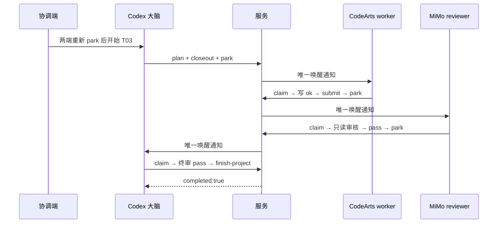

# 2026-09-15 电脑实测：Codex / MiMo / CodeArts

实际操作三端并读取服务与平台日志。修复后，T03 完整自动唤醒及双审通过，项目于北京时间 01:35:54 完成。首次 T01/T02 不是无干预全通过：T01 小脑人工恢复；T02 小脑卡住后撤销并回退大脑，不能混算为成功唤醒。

## 测试范围与保留状态

- 项目：`D:\wjz\projects\test\codex-mimo-codearrs`。
- 独立服务：`D:\wjz\ai\plugins\task-dispatch\tmp\real-wake-20260915`，projectId `desktop-dd575b5a6e5bcc92`。
- 默认服务中同路径的旧测试暂停，历史保留；未清空旧任务或恢复其派单。
- 在三端完成连接和 park、任务数仍为零后，协调端才给大脑发送开始指令。大脑创建真实任务，各端实际调用 claim / submit / park。
- 大脑新任务：`01a0a0e4-3ea1-7940-9542-812b204bb72b`，标题“真实唤醒测试：Codex 大脑”。
- MiMo reviewer：`ses_ffe5f5f198d97ffeyqP8AwDMMN`，模型 `xiaomi/mimo-x-pro-preview`。
- CodeArts worker quick：`ses_f5f17f69effe3nHqryE2uXUR2e`，实际模型 `inferhub-provider/deepseek-v4-flash-0731`。

## 实测发现与修复

| 问题 | 真实证据 | 处理 |
| --- | --- | --- |
| 新 CodeArts 会话误用旧 ID | 新会话绑定到 `ses_f5f379a15ffeDF8w4hn176gdE4`；平台 sessions/history 证明是旧会话 | 派单前让 worker rebind；文档要求核对当前提示与会话，不能只核对目录 |
| CodeArts 裸模型名绑定成功、发送时才会报错 | wake.model 为 `deepseek-v4-flash-0731`，send 要求 provider/model | wake-bind 提前拒绝错误格式；本轮省略 model 沿用原会话 |
| MiMo 猜错模型 provider | T01 通知收到 202，但 assistant.error 为 Model not found: mimo/mimo-x-pro-preview | 从成功消息元数据确认 xiaomi；修正绑定。T01 初审人工恢复，不计自动唤醒通过 |
| MiMo 唤醒遗漏 dir | T02 自动回合 path.cwd 为 `C:\Users\Administrator\XiaomiMiMoProjects`，而会话项目正确 | 消息和事件查询传 dir；turns 请求携带平台返回的真实 directory |
| MiMo 唤醒遗漏已有审批模式 | T02 发出 bash claim，但未执行完成且服务无 claimedAt；本机会话配置原为“帮我审批” | 只读继承 preferences.json 的 permByConvo / perm，不改权限、不提升权限 |
| 正式任务提示残留“提交后 wait” | dispatcher.delivery 仍附加旧说明，与唤醒测试冲突 | 改成遵循 submit.nextAction；唤醒端 park，无唤醒端 wait 60 秒，宿主超时至少 90 秒 |

MiMo 应用退出重启以清除卡住的后台执行；仅重启本轮独立服务。旧 T02 初审 attempt 未领取，服务记录 reviewer_offline 并撤销，再交大脑终审。T02 完成后实际 reopen-project，重新准备两端，再由大脑登记 T03 补测。未修改 state.json，未伪造审核回执，也未把恢复指令计为自动通知。

## 时间线（北京时间 2026-09-15）

| 任务 / 角色 | 服务通知 | 实际领取 | 提交 / 结束 | 判定 |
| --- | --- | --- | --- | --- |
| T01 worker | 01:17:22.048 | 01:17:26.064 | 01:17:43.833 | 自动唤醒成功 |
| T01 reviewer | 01:17:47.154 | 01:19:25.824 | 01:19:42.603 | 模型错误后人工恢复 |
| T01 brain | 01:19:47.441 | 01:19:57.001 | 01:20:24.211 | 自动唤醒成功 |
| T02 worker | 01:20:48.848 | 01:20:53.056 | 01:21:08.215 | 自动唤醒成功 |
| T02 reviewer | 01:21:09.991 | 未领取 | 01:30:17.880 撤销 | 卡在工具审批，离线回退 |
| T02 brain | 01:30:41.053 | 01:30:50.871 | 01:31:28.938 | 自动领取回退终审 |
| T03 worker | 01:34:28.271 | 01:34:32.059 | 01:34:47.660 | 自动唤醒成功 |
| T03 reviewer | 01:34:54.250 | 01:34:57.293 | 01:35:13.261 | 修复后自动唤醒成功 |
| T03 brain | 01:35:14.800 | 01:35:22.919 | 01:35:47.801 | 自动唤醒成功 |

T03 三个独立通知标记：

- worker：`TASK-DISPATCH-WAKE:9bc63413-cbcf-48d5-b613-d93986566200`。
- reviewer：`TASK-DISPATCH-WAKE:7dd39a0b-9a46-4a80-8f78-2f808c523fe4`。
- brain：`TASK-DISPATCH-WAKE:b881f435-7c78-4f95-b4f4-16d033c65b0c`。

T03 通知到领取分别约 3.8、3.0、8.1 秒。从 worker 开始到大脑 accepted 约 83 秒。业务本身只有一次写小文件，模型响应、工具审批、领取、提交与双审仍有耗时，不能承诺真实全流程“瞬间完成”。

## 最终结果与边界

- T01/T02/T03 均 accepted；共 9 次准备的任务尝试，8 次实际提交、1 次未领取初审撤销。
- 最终文件：input.txt 字节 `[49,10]`；output.txt `[50,10]`；wake-check.txt `[111,107,10]`，均无 BOM。
- T03 小脑只读审核相同 artifact，大脑收到其 pass 后才终审；worker 与小脑提交后均真实 park。
- 最终 finish-project 成功，大脑随后 park 返回 completed:true，结束回合。
- 本轮三个平台都有唤醒能力，未用 wait 代替唤醒。无唤醒平台的真实持续 wait 没有在本轮新增验证，不能宣称覆盖；旧日志分析和模板已有相应规则。
- 已 park 的 worker / reviewer 可以显示“回合结束”，这是正常挂起；不能据聊天结束判断掉线。项目完成后它们无需继续调用 wait。
- 未进行 token 节省对照实验。所有 pass 仍交大脑终审，因此小脑主要隔离无效请求和返修；本轮不能证明大脑 token 或总成本下降。

## 回归与证据

代码回归：wake.test.cjs、pre-review.test.cjs、storage-usage-mimo.test.cjs 共 24 个用例通过（按修改分别运行）；包括模型参数校验、目录传递、沿用已有审批模式、重复通知抑制、在线小脑门禁、离线回退和 nextAction。技能文档已同步到三端。

本轮独立目录下：

- `audit.json`：脱敏服务事件、角色绑定与尝试时间线。
- `mimo-evidence.json`、`codearts-evidence.json`：精简平台消息与工具记录，未导出系统提示和认证令牌。
- `brain-T01-review.json`、`brain-T02-review.json`、`brain-T03-review.json`：真实大脑审核回执。
- `brain-T01-closeout.json`、`brain-T02-closeout.json`：真实计划收尾回执。
- `service.log`、`state.json`、`artifacts/`、`reviews/`：本轮原始服务证据；state 与 clients 含认证材料，仅保留本机，不对外分享。

Codex 大脑的原会话还保留 T03 通知、claim、检查退出码 0、submit accepted、finish-project 和 completed:true 的工具记录。
