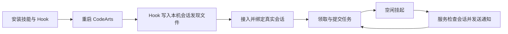

# CodeArts 原会话接入

0.4.0 支持 CodeArts（参数 `codearts`，兼容 `codeartsdoer`）的已有会话唤醒。MiMo、Codex 的唤醒适配器同样默认注册；不需要额外启用平台开关。绑定仍需真实会话信息，绑定后 `park` 才会允许发送通知。



## 安装

当前 Skill 安装器仅面向 brain 平台，不再接受 `codearts` / `codeartsdoer`。CodeArts 只保留为已有 worker Hook 环境的运行时兼容适配器；新环境不应通过 task-dispatch 安装器部署 CodeArts Skill 或 Hook。已有 Hook 环境升级时需由其原部署方式维护，并在变更后重启 CodeArts。

Hook 使用当前进程的 `OPENCODE_SERVER_USERNAME` / `OPENCODE_SERVER_PASSWORD` 和插件上下文 `serverUrl`，按会话 ID 的 SHA-256 文件名写入 `~/.codeartsdoer/task-dispatch/`。同机多个会话分别发现，每次请求重新读取端口和凭据。凭据文件不得提交、粘贴或输出到日志。Hook 不发送消息、不接管角色、不自动领取任务。

若 CodeArts 版本没有提供 `serverUrl` 或密码环境变量，Hook 不生成发现信息，需要核实该版本插件接口；不能把安装成功当作连接成功，也不从其他进程的 StartInfo 猜测密码。

## 绑定

先按 [桌面接入](desktop.md) 执行 `connect` 或 `attach`，确认当前角色与项目。读取平台提供的当前 session ID，不按标题猜测，也不使用其他窗口 ID。宿主界面给不出会话 ID 时，用受支持的只读通道定位，不要自己翻宿主数据：

1. 先把该角色当前的邀请或改绑提示词原样发给这个 CodeArts 会话——其中带 `[TASK-DISPATCH-INVITE:<uuid>]` 标识，Hook 同时按会话写出 `~/.codeartsdoer/task-dispatch/<sha256(sessionId)>.json`。
2. 再执行只读诊断，按项目目录匹配该标识，唯一命中才可用：

```powershell
node "<客户端脚本>" discover-session --provider codearts --invitation-id "<uuid>" --workspace "<项目绝对路径>"
```

3. 返回 `identified:false`（未命中或多条歧义）时停止并报告缺项，向用户索要真实会话 ID。禁止手工打开宿主 `opencode.db` 或任何宿主数据库查 `session` 表——邀请文案明确不读宿主数据库，按目录或更新时间猜会话同样不允许。

随后执行：

```powershell
node "<客户端脚本>" wake-bind --provider codearts --thread-id "<真实session ID>" --credential "<本会话凭据文件>" --data "<服务数据目录>"
node "<客户端脚本>" claim --credential "<本会话凭据文件>" --data "<服务数据目录>"
node "<客户端脚本>" park --credential "<本会话凭据文件>" --data "<服务数据目录>"
```

CodeArts 不需要 Codex turnId。可选 `--model provider/model` 明确模型，否则由平台沿用会话模型。0.4.0 客户端默认开启实验性绑定，旧 `--experimental` 参数继续兼容；`wake-disable` 仍可关闭。MiMo 必须提供明确的 `--model provider/model`。

新建会话不能复用同目录旧会话的发现文件 ID。核对平台会话历史中的当前初始提示，确认 session ID 后再接入；仅目录相同不足以证明身份。界面只显示裸模型名时省略 `--model`，不要将裸模型名作为完整 provider/model 传入。

使用 OpenCode HTTP 接口读取会话、历史和状态，通过 `POST /session/{id}/prompt_async` 发送 UTF-8 通知，只有 204 确认为接收。异步接口避免同步等模型回复阻塞调度；不支持该接口时显示错误，不盲目回退重发。接收不等于任务完成，仍须 claim、submit、park。忙碌时等待，送达不确定时核对历史标记。

接口依据：[OpenCode Server](https://opencode.ai/docs/server/)、[插件接口定义](https://github.com/anomalyco/opencode/blob/dev/packages/plugin/src/index.ts)。CodeArts 的具体版本仍需真实环境联调。
