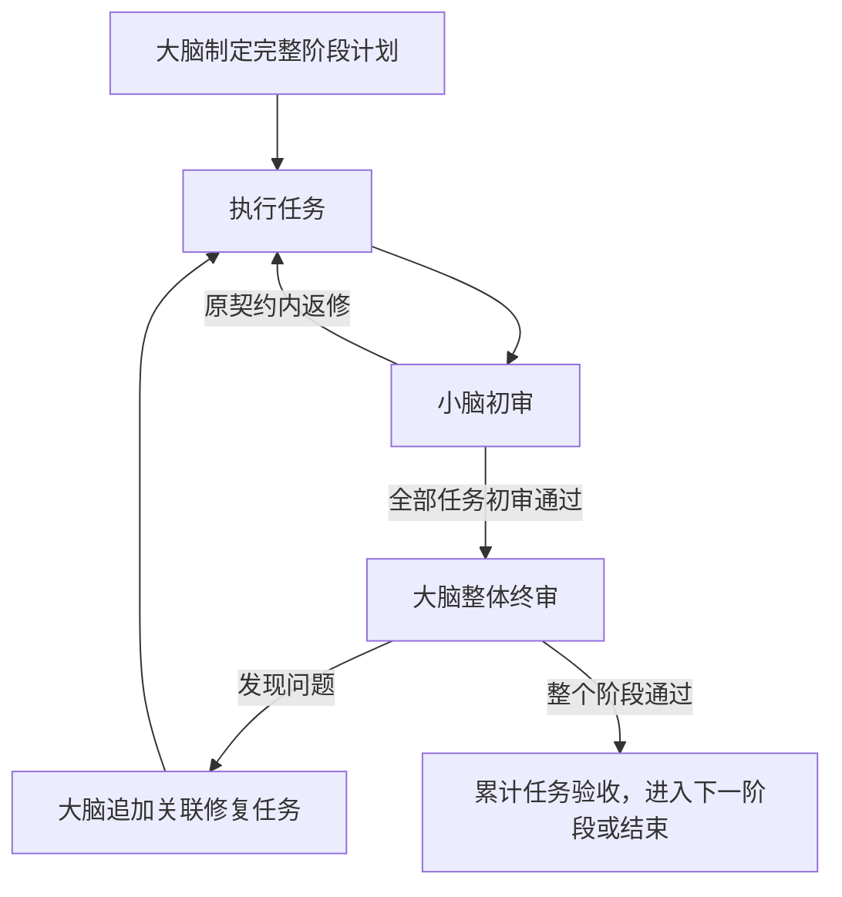

# 阶段计划与终审

1.0.0 仅支持阶段集中终审。服务数据使用 version 2；旧数据会明确拒绝加载，不自动迁移、不删除旧目录。使用新服务数据目录和重新接入的角色，不能让旧客户端继续操作新版项目。安装和重启真实服务仍需处于用户授权范围内。



## 提交阶段计划

大脑在 start-work 成功后按依赖顺序用 `plan --file` 登记各项任务。登记不派发。然后提交阶段 JSON：

```json
{
  "stageId": "login",
  "roundId": "login-r1",
  "milestone": "完整登录功能及相关修复",
  "acceptance": "登录、退出、失败提示符合要求，已有功能无回归",
  "members": [{"taskId": "L1"}, {"taskId": "L2"}]
}
```

```powershell
node "<客户端脚本>" stage-register --file "<阶段JSON>" --credential "<大脑凭据>" --data "<服务目录>"
```

小脑必须在线。成员必须是未执行的任务；一个阶段可以只有一个成员。阶段内普通依赖由初审通过释放；跨阶段依赖必须已 accepted 或 resolved。执行保持共享工作区串行，不要求成员文件互不重叠。登记后任务清单冻结，worker 和 reviewer 都无权改变计划。状态中的 stageHeld 表示初审通过，不能当作最终验收。

## 阶段终审

全部成员初审通过后，大脑领取 `kind=stage_review`。阅读整合后的候选和 `.dispatch-evidence/stage.json`，其中包含阶段完整目标、累计任务、初审、验证报告、上轮问题及修复关联。配置的自动验证会在整合候选上重新运行；未配置验证会明确记录为 unconfigured，不代表测试通过。

按 job 给出的身份、contractHash 和 compositeArtifactHash 提交整体 verdict、summary、findings，以及 members 中每项的 verdict、summary、findings、taskId、artifactId。整体与所有成员均 pass、没有 findings、配置检查未失败，才能最终通过。问题包含稳定 key、文件位置、触发条件、影响和必要修复。

```powershell
node "<客户端脚本>" stage-submit --file "<终审JSON>" --credential "<大脑凭据>" --data "<服务目录>"
```

小脑和执行员仍使用 `submit` 提交单任务回执。大脑不使用该入口逐项终审。

## 追加修复轮

整体终审不通过时，原任务保留初审通过状态和所有证据，不重置、不算 accepted。大脑追加新 ID 的修复任务，保持相同 stageId、milestone、acceptance，使用新 roundId。每个修复任务的 repairKeys 从上一轮 `status.reviewStages.rounds[].issues[].key` 复制，完整覆盖所有问题：

```json
{
  "stageId": "login",
  "roundId": "login-r2",
  "milestone": "完整登录功能及相关修复",
  "acceptance": "登录、退出、失败提示符合要求，已有功能无回归",
  "members": [{"taskId": "L3", "repairKeys": ["stage:error-message"]}]
}
```

再次 stage-register 后，执行与初审新任务；大脑下一次终审包含原任务和全部修复任务。阶段通过后才进入新功能阶段。新阶段使用新 stageId。

## 异常

任务 blocked、uncertain、额度不足或 reviewer 离线会通知大脑。优先处理 task_attention / scope_attention 中的具体问题，必要时 retry、改派或补充额度，再调用 `stage-resume --round <roundId>`。不因等待时间长撤销已领取审核。准备终审中断时，只有核实验证子进程已停止后才加 `--confirmed-stopped` 恢复；已领取的终审保留所有权，不能重放。

小脑按原契约返修无需改阶段计划；需要改变已执行契约时不能直接 revise-task 或 configure-repair。应向大脑报告具体阻塞，不擅自改约定。阶段不是空队列判定：只有大脑整体验收通过且项目所有已登记任务终结，才可 finish-project。

大脑确需修订尚未执行的阶段成员时，先暂停项目并等待空闲边界，再调用 revise-task，填写原因；服务记录旧契约并更新阶段契约摘要。小脑、执行员无此权限；已执行任务仍不可改写契约。
